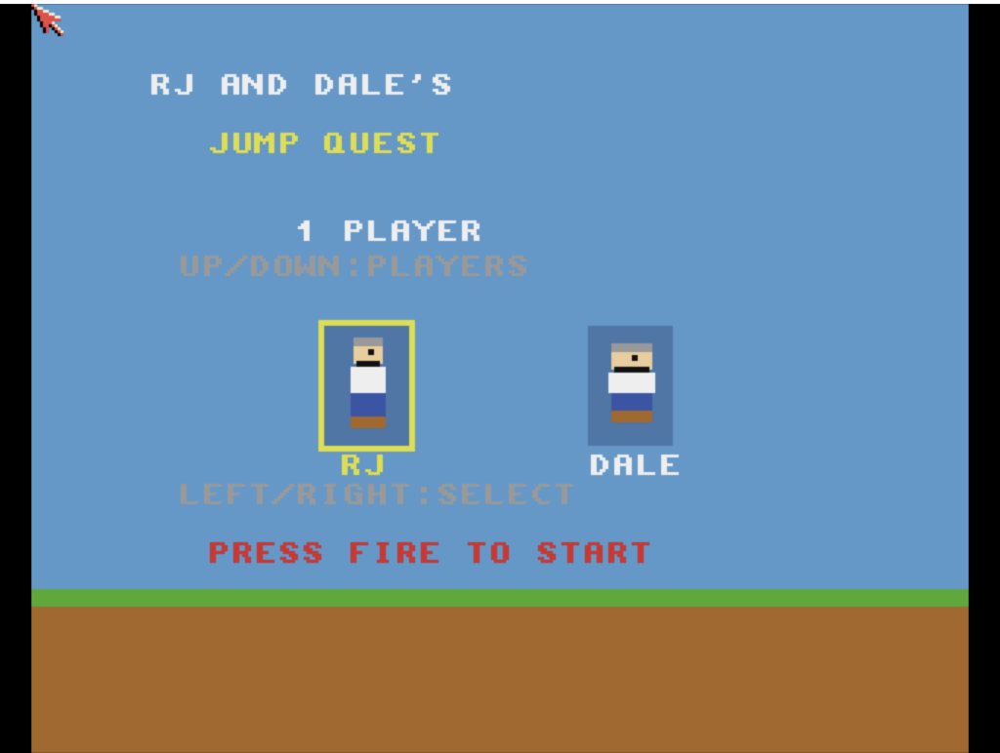

# Jump Quest
**Platform:** Classic Amiga (68k, AGA A1200/A4000 class) · **Source:** `examples/jump_quest/` · **Type:** game

A platformer starring RJ and Dale, for one or two players taking turns, with three levels defined in `src/levels/`. It draws on a double-buffered 16-colour screen (`ChangeScreenBuffer`) and plays bouncy chiptune music and procedural sound effects directly on Paula (channels 0-1 music, 2-3 effects). It registers with the bridge as `jump_quest`, exposing `score`, `lives`, `health`, `level` and `state` plus `reset` and `skip_level` hooks.

## Title screen

"RJ AND DALE'S JUMP QUEST" with 1 PLAYER selected, a character select with RJ highlighted in a yellow box next to DALE, PRESS FIRE TO START, over a grass-and-dirt strip.

## Gameplay

RJ jumps over grassy ground near a brown crawling enemy and green bushes; a floating brick block carries a red/yellow gift box and a green item, with a pit to the right. The HUD shows RJ's health hearts, SCORE 100, LIVES 3 and LV 1.

**Controls:** Cursor keys, WASD or joystick: move · Space, left Alt, Z, C or fire: jump · Title: left/right pick RJ or Dale, up/down 1 or 2 players · Return, Space or fire: start · Esc: quit
