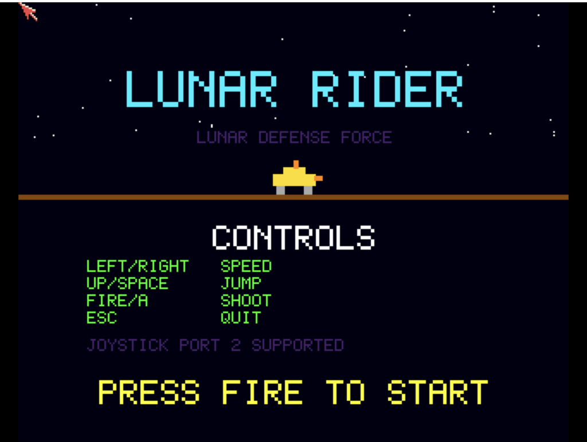

# Lunar Rider
**Platform:** Classic Amiga (68k, AGA A1200/A4000 class) · **Source:** `examples/lunar_rider/` · **Type:** game

A side-scrolling moon-buggy ride: jump craters, shoot rocks, UFOs and meteors, and reach each zone. The background uses parallax layers scrolling at 0.25x and 0.5x speed behind the terrain on a double-buffered 16-colour screen, and the sound runs directly on Paula with three effect channels and a bouncy bass melody on the fourth. It registers as `lunar_rider` with `score`, `lives`, `checkpoint` and `state` variables and `reset` and `status` hooks.

## Title screen

"LUNAR RIDER / LUNAR DEFENSE FORCE" with the yellow buggy, the CONTROLS list, JOYSTICK PORT 2 SUPPORTED and PRESS FIRE TO START.

## Gameplay

The yellow moon buggy is mid-jump over cratered brown ground with a purple mountain backdrop, firing orange shots upward and forward. The HUD shows SCORE 0, the ZONE 01 progress bar, LIVES 3 and HI 0.

**Controls:** Cursor left/right (or D), joystick left/right: slow down / speed up · Cursor up, W, Space or joystick up: jump · A or fire: shoot (fire or jump starts) · Esc: quit
