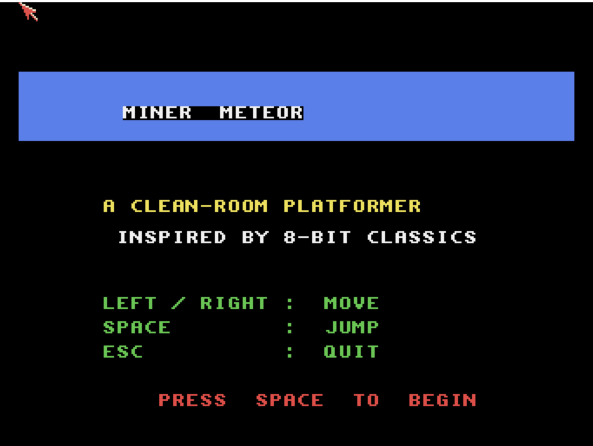

# Miner Meteor
**Platform:** Classic Amiga (68k, AGA A1200/A4000 class) · **Source:** `examples/miner_meteor/` · **Type:** game

A clean-room single-screen tile platformer in the style of early-1980s 8-bit games: each level is a fixed 20x15-tile room with keys to collect, an exit that unlocks after the last key, and hazards such as spikes, patrolling guardians, conveyors and collapsing floors, while the air supply drains. Written in C++, it opens a 320x256 8-bitplane AGA screen (using the first 16 palette entries) and redraws tile by tile with RectFill into a double buffer; the audio functions are stubs. It registers with the bridge as `miner-meteor` and exposes `mode`, `level`, `lives`, `score`, `air` and `keys_remaining`; the stubbed sound calls log jump, land, key, death and level-win events with `AB_I`.

## Title screen

A blue "MINER METEOR" banner with "A CLEAN-ROOM PLATFORMER / INSPIRED BY 8-BIT CLASSICS", the keys (left/right move, Space jump, Esc quit) and PRESS SPACE TO BEGIN.

## Gameplay

The starting screen of level 1: a red brick border and floating brick platforms, four yellow keys, the miner at bottom-left and a grey arched exit door. HUD: SCORE 000000, a green air bar, LV1, K0/4, L3. Capture note: as with Emberkeep, injected movement keys did not move the player in this session, so only the start position was captured.

**Controls:** Cursor left/right or A/D: walk. Space or cursor up: jump (Space: start / return on the title). Joystick fire: jump / start. Esc: quit.
