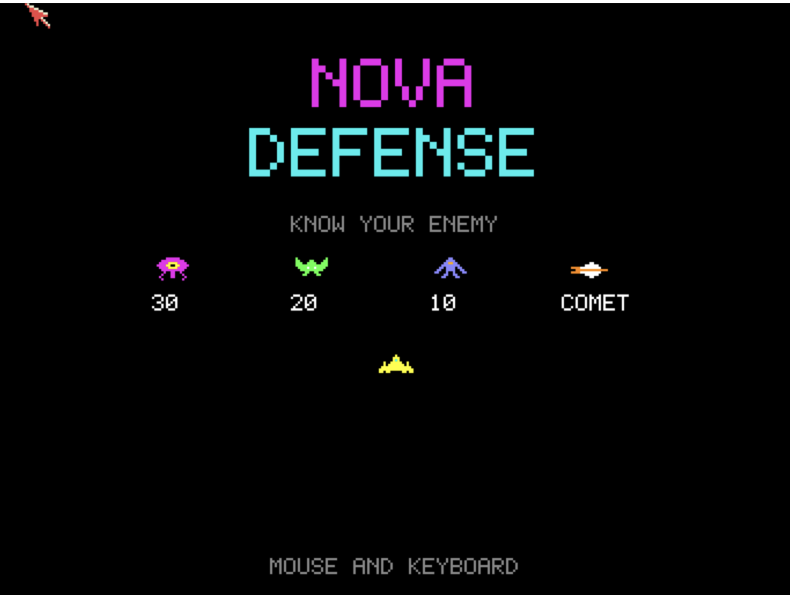
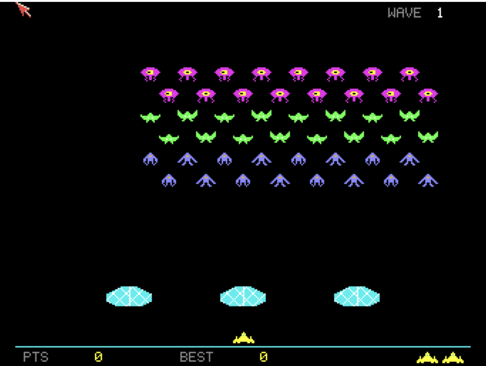

# Nova Defense
**Platform:** Classic Amiga (68k, AGA A1200/A4000 class) · **Source:** `examples/nova_defense/` · **Type:** game

A fixed-screen alien shooter: 48 aliens in staggered rows, crystal shields and a passing comet. It runs on a double-buffered 16-colour (4-bitplane) PAL screen flipped with `AllocScreenBuffer`/`ChangeScreenBuffer`, with marching notes and effects played straight on Paula's registers from waveforms in chip RAM. During development it registers with the AmigaBridge as `nova_defense`, exposing `score`, `hiscore`, `lives`, `wave`, `aliens_alive` and `state` as live variables plus `reset` and `status` hooks callable from DevBench.

## Title screen

The "NOVA / DEFENSE" logo in magenta and cyan above a "KNOW YOUR ENEMY" table: a magenta eye alien worth 30, a green alien worth 20, a blue alien worth 10 and the comet, with the yellow player ship below and "MOUSE AND KEYBOARD" at the bottom.

## Gameplay

Wave 1 at the start: six staggered rows of aliens (magenta, green, blue), three cyan crystal shields, and the yellow ship on the ground line. The HUD shows PTS 0, BEST 0 and two reserve ships.

**Controls:** Mouse, cursor left/right or A/D: move · Left mouse button, Space or Alt: shoot (and start) · Esc: quit
