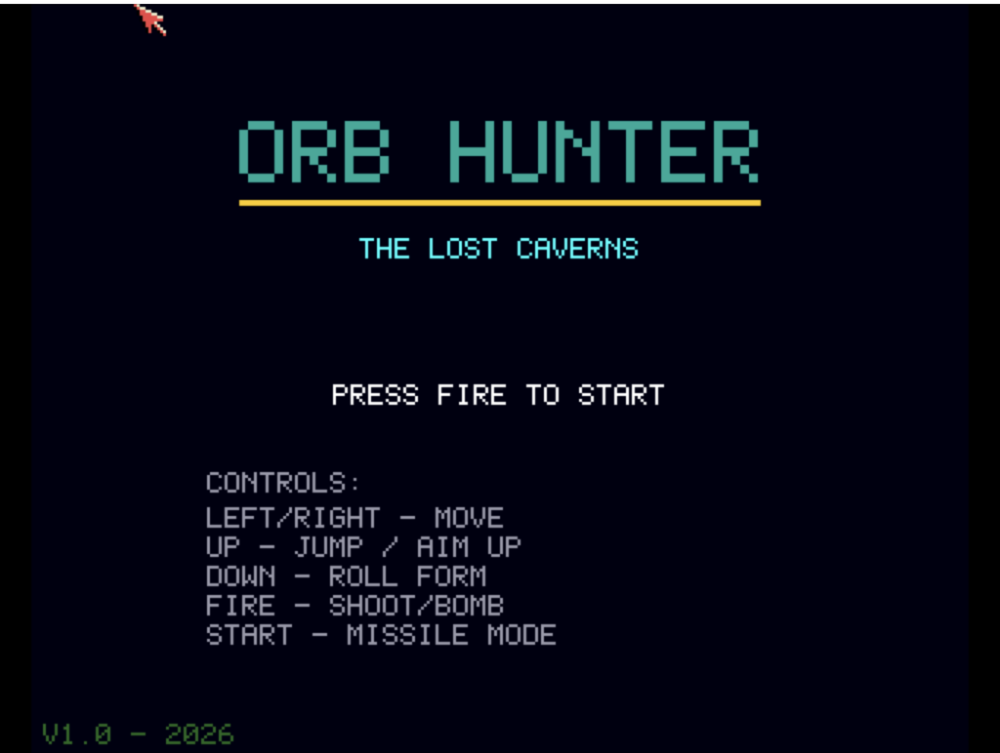

# Orb Hunter
**Platform:** Classic Amiga (68k, AGA A1200/A4000 class) · **Source:** `examples/orb_hunter/` · **Type:** game

A cavern-exploration platformer with tile-based rooms, power-ups (roll form, missiles, bombs, beams), several enemy types and bosses. It draws on a double-buffered 16-colour (4-bitplane) screen and plays Rock Blaster's ProTracker module through Frank Wille's ptplayer (when `rock_blaster.mod` is beside the program), with synthesised sound effects. As the `orb_hunter` bridge client it exposes `health`, `max_energy`, `missiles`, `max_missiles`, `room_x` and `room_y`, and registers `reset`, `give_items` and `full_health` hooks for testing; MOD loading and validation results are logged over the bridge.

## Title screen

"ORB HUNTER / THE LOST CAVERNS" with PRESS FIRE TO START, the control list (left/right move, up jump / aim up, down roll form, fire shoot / bomb, start missile mode) and "V1.0 - 2026".

## Gameplay

The green-brick cavern room "WYRM HOLLOW": the teal-suited hero stands on the floor firing a green shot, a purple crawler approaches from the left and a cyan orb floats nearby, with the PW energy bar (025), a minimap top-right and debug text (Y208 F224 R3.3). Capture note: in FS-UAE the in-game screen showed only the background colour on every attempt, so this image is the bridge's own screenshot (`amiga_screenshot`, which reads the screen bitmap over the serial link), 320x256 scaled up 3.2x.

**Controls:** Cursor keys / WASD or joystick: move. Up: jump / aim up; Down or Z: roll form. Space, left Shift, left Alt or fire: shoot. Return or fire: start; Esc: quit.
