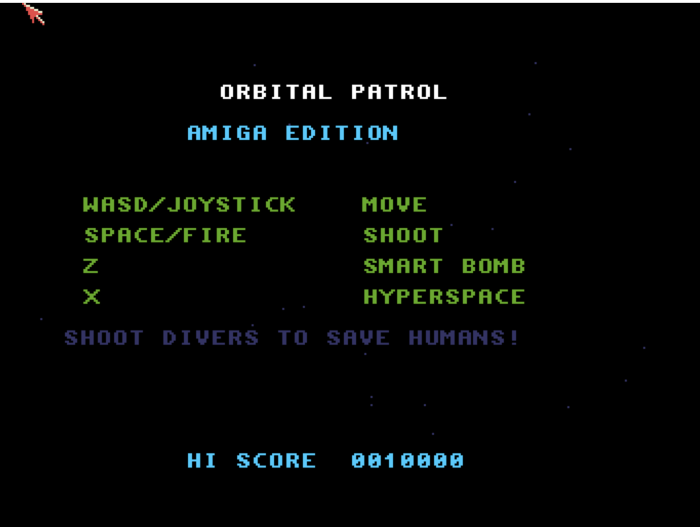

# Orbital Patrol
**Platform:** Classic Amiga (68k, AGA A1200/A4000 class) · **Source:** `examples/orbital_patrol/` · **Type:** game

A side-scrolling planet-defence shooter: protect the humans from abductors across a wraparound world six screens wide, with a scanner showing the whole world, six enemy types, smart bombs and hyperspace. It has multi-layer parallax scrolling on a double-buffered 16-colour screen, ProTracker music (`orbital_patrol.mod`) via ptplayer plus procedural effects, and a high-score table saved to disk. It registers as `orbital_patrol` with variables `score`, `lives`, `level`, `smart_bombs`, `enemies_alive`, `humans_alive`, `state` and `input`, and test hooks `add_bomb`, `add_life`, `invuln`, `kill_all`, `next_level`, `keys`, `reset` and `status`.

## Title screen

"ORBITAL PATROL / AMIGA EDITION" with the control list (WASD/joystick move, space/fire shoot, Z smart bomb, X hyperspace), "SHOOT DIVERS TO SAVE HUMANS!" and HI SCORE 0010000.

## Gameplay

Over a green jagged planet surface, a green alien abductor carries a white human up from the ground while the yellow player ship at lower right fires white laser shots. The scanner strip runs across the top; the HUD shows score 0000300, HI 0010000, W1 H10 and three markers.

**Controls:** Cursor keys, WASD or joystick: fly · Space, Alt, left Shift or fire: shoot · Z: smart bomb · H or X: hyperspace · Return, Space or fire: start · Esc: quit · High-score entry: cursor keys / joystick pick letters, fire confirms
