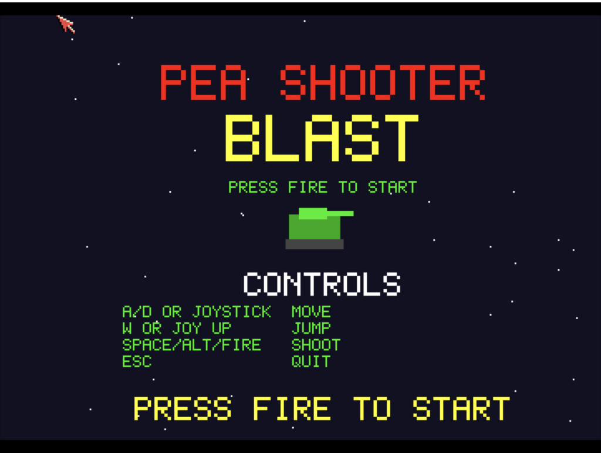

# Pea Shooter Blast
**Platform:** Classic Amiga (68k, AGA A1200/A4000 class) · **Source:** `examples/pea_shooter_blast/` · **Type:** game

Side-scrolling tank action with ladders, enemies, bosses and eight weapon levels. Its tile engine scrolls smoothly by drawing into an oversized bitmap and setting the viewport's `RxOffset` with `ScrollVPort`, combined with `ChangeScreenBuffer` double buffering on a 16-colour screen; music is a ProTracker module (`music.mod`) played via ptplayer. It registers with the bridge as `pea_shooter` with tunable `tank_speed`, `jump_power`, `gravity`, `bullet_speed`, `enemy_speed`, `weapon_level`, `health`, `start_lives` (plus `score`, `level`, `lives`) and hooks `add_life`, `heal`, `max_weapon`, `next_level` and `reset`.

## Title screen

A red "PEA SHOOTER" and yellow "BLAST" title with the green tank and the control list.

## Gameplay

The green tank on brown ground fires a pea at a red robot enemy, with a brown ledge to the right. The HUD shows the HP bar, GUN 1, LV1 and score 0.

**Controls:** Cursor left/right, A/D or joystick: move · Cursor up, W or joystick up: jump / climb, down or Z: climb down · Space, left Shift, left Alt or fire: shoot (and start) · Esc: quit
