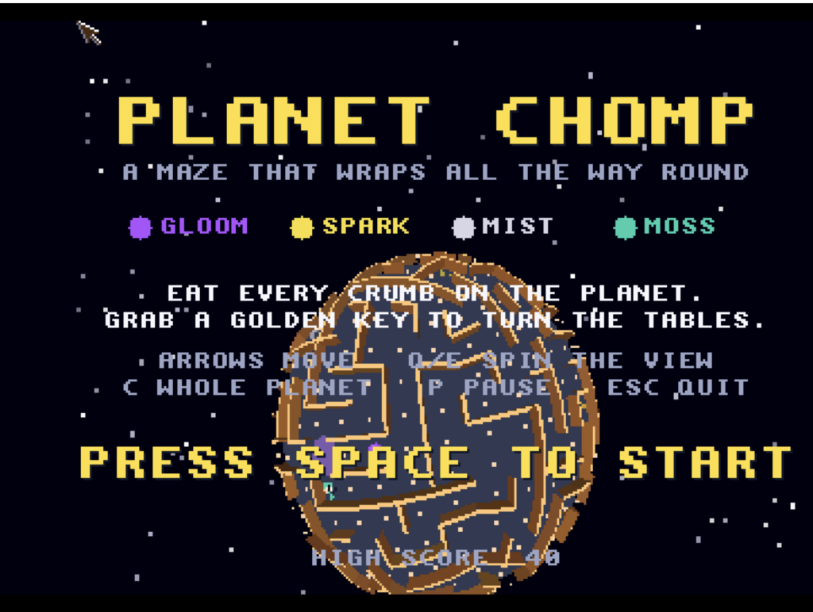
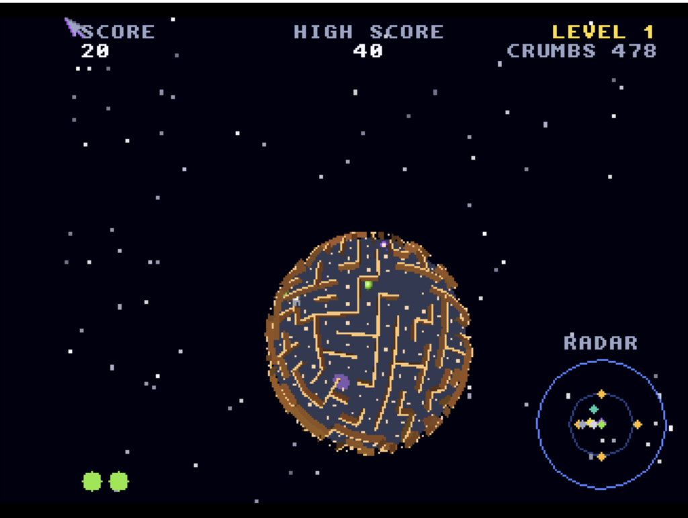

# Planet Chomp (68k)
**Platform:** Classic Amiga (68k, AGA A1200/A4000 class) · **Source:** `examples/planet_chomp/` (68k build, `make ARCH=m68k`) · **Type:** game

A maze chase on a tiny planet: the maze wraps all the way round a sphere, and you eat every crumb while dodging four spooks, grabbing a golden key to turn the tables. This classic 68k build (68020+, no FPU or 3D library needed) runs the 3DO version's integer-maths game and renderer code unchanged, with its flat quads and scaled sprites ("cels") drawn in software into a 15-bit RGB frame; on AGA that frame goes to a 320x256 8-bitplane screen with a 256-colour palette fitted to the colours on screen (median cut), converted chunky-to-planar and double buffered, and on RTG to a Picasso96 window or screen. The 3DO's synthesised sounds play on Paula with samples in chip RAM. As the `PLANET` bridge client it exposes `score`, `hiscore`, `level`, `lives`, `state`, `crumbs`, `demo`, `fps10`, `walls` and `prims`, with a `press` hook that holds a pad button and a `quit` hook, and logs game events (chomps, level clears, deaths) with `AB_I`.

## Title screen

"PLANET CHOMP / A MAZE THAT WRAPS ALL THE WAY ROUND" introducing the four spooks GLOOM, SPARK, MIST and MOSS, with the rules, keys, PRESS SPACE TO START and HIGH SCORE 40, over the spherical maze planet rotating behind the text.

## Gameplay

A close-up of the sphere: a dark blue maze floor with tan walls curving round the planet, white crumbs, the green chomper and a purple spook nearby, with a RADAR circle bottom-right. SCORE 0, HIGH SCORE 40, LEVEL 1, CRUMBS 480, two lives.

## Gameplay: whole-planet view

The whole-planet view (C key): the entire maze sphere shown small in a starfield, with the radar, SCORE 20 and CRUMBS 478.

**Controls:** Arrows / WASD / keypad: steer (a turn waits for the next junction). Q/E or Z/X: spin the view. C: whole planet. P: pause. Space: start. Esc: quit. F or F10: window / full screen (RTG). Joystick in port 1 also works (fire = start).
