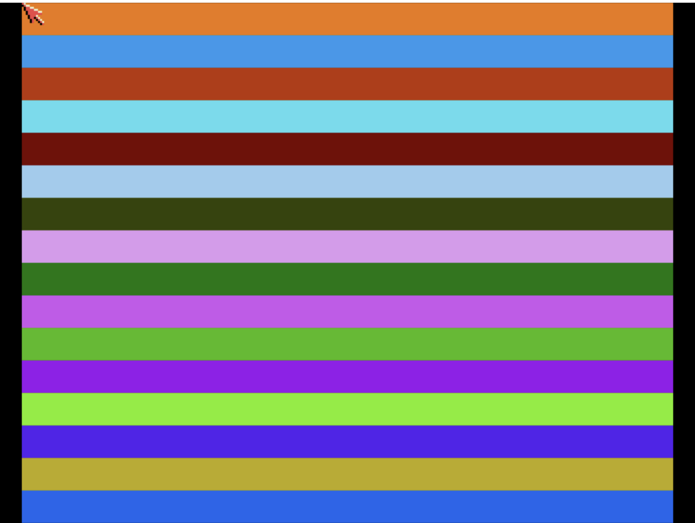

# Plasma
**Platform:** Classic Amiga (68k, AGA A1200/A4000 class) · **Source:** `examples/plasma/` · **Type:** demo

Colour-cycling plasma bands on a 320x256, 16-colour screen: 16 horizontal bands whose palette is recomputed from a sine table each frame and loaded with `SetRGB4`. It is a small showcase of bridge control: it registers as `plasma` with variables `speed`, `palette_offset`, `red_freq`/`green_freq`/`blue_freq`, `brightness` and `frame_count`, hooks `randomize`, `reset`, `to_back` and `to_front`, and memory regions `palette_r`/`palette_g`/`palette_b` exposing the live palette.

## Running

The full screen of 16 horizontal colour bands, palette-cycling.

## After randomize

The same bands after calling the bridge hook `randomize`, which picked a new colour set (r=9 g=9 b=8).

**Controls:** Esc quits. **Bridge hooks:** `randomize`, `reset`, `to_back`, `to_front`.
