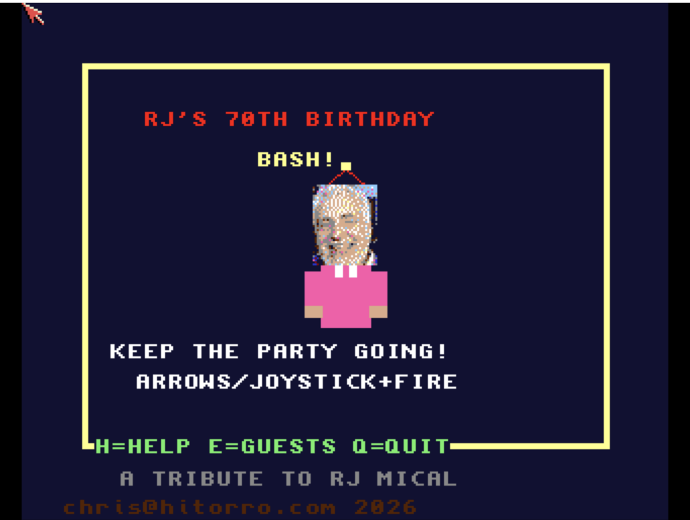
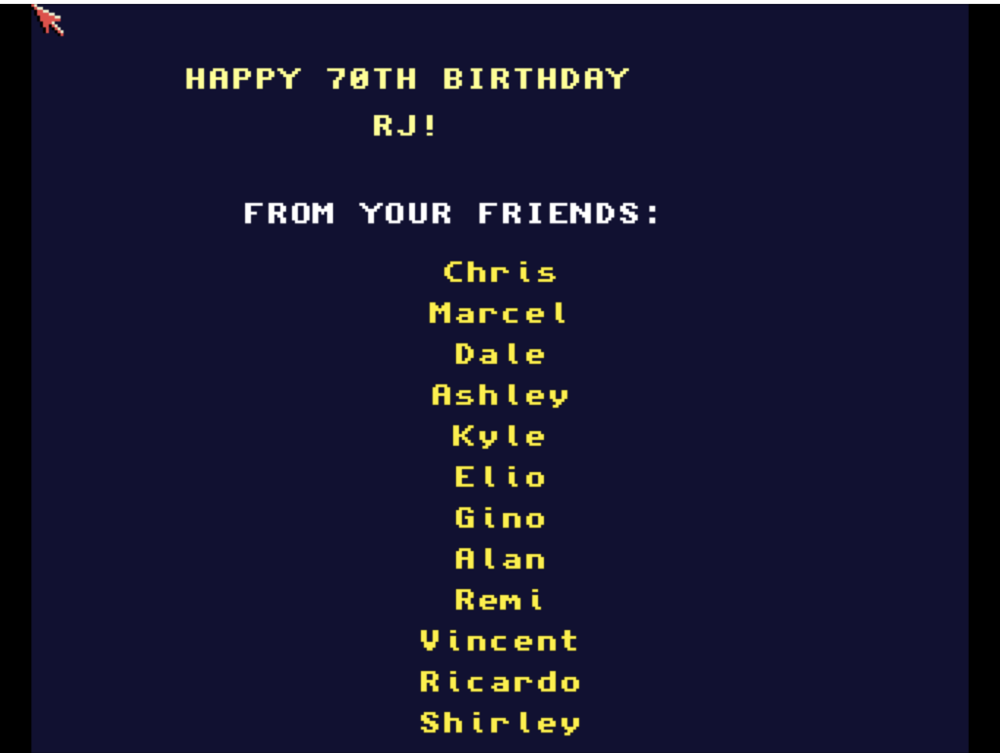

# RJ's Birthday Bash
**Platform:** Classic Amiga (68k, AGA A1200/A4000 class) · **Source:** `examples/rj_birthday/` · **Type:** game

An arcade party-management game written as a tribute to RJ Mical (Intuition, Amiga, Atari Lynx, 3DO) for his 70th birthday: run the party across six themed rooms of RJ's house, keeping guests happy, catching gifts and serving food. RJ's head is a 32x40 sprite generated from a photo (`rj_head.jpg`) and dithered to the game's 16-colour palette; the screen is double-buffered, and music switches between `party.mod` and `birthday.mod` via ptplayer, alongside arcade voice samples (`snd_arcade*.raw`, with a synthesised fallback) and synthesised effects. As the `rj_birthday` bridge client it exposes `score`, `lives`, `room`, `happiness`, `wave` and `clock`, with `reset`, `add_life` and `set_room` hooks (jump to room 0-5); the guest list is loaded from `guests.txt` and editable in-game.

## Title screen

A framed "RJ'S 70TH BIRTHDAY BASH!" title with the digitised photo face on a pink-shirted sprite, "KEEP THE PARTY GOING!", the keys H=HELP, E=GUESTS, Q=QUIT and "A TRIBUTE TO RJ MICAL".

## Gameplay

THE FOYER: a beige wall hung with red, blue and yellow balloons and a "HAPPY 70TH!" banner, RJ in a party hat walking past a wrapped present and a door frame, with the next room's green edge scrolling in on the right. SCORE 100, three party-hat lives, party clock 7:08.

## Credits

The credits shown after pressing Esc: "HAPPY 70TH BIRTHDAY RJ! FROM YOUR FRIENDS:" followed by a list of first names.

**Controls:** Cursor keys or joystick: move; Space, left Alt or fire: act. Title: H help, E guest list, Q quit. E in play: guest list (up/down, Return add, Del remove, Esc save). Esc: leave the party (credits, then title).
