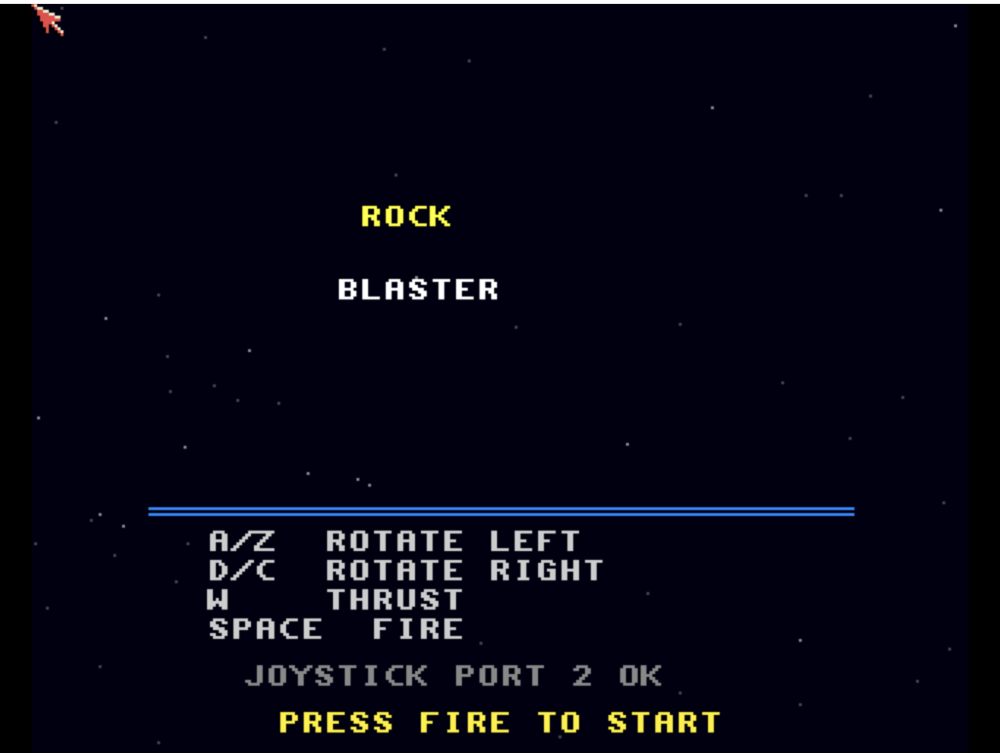

# Rock Blaster
**Platform:** Classic Amiga (68k, AGA A1200/A4000 class) · **Source:** `examples/rock_blaster/` · **Type:** game

A vector rock shooter: rotate, thrust and blast drifting rocks that split from large to medium to small. Ship, rocks and particle explosions are line-drawn on a double-buffered 16-colour screen (`ChangeScreenBuffer`) with screen wrapping and thrust/drag physics, and it plays original ProTracker music (`rock_blaster.mod`) via ptplayer. It registers as `rock_blaster` with tunable variables (`ship_thrust`, `bullet_speed`, `rock_speed`, `start_rocks`, `rocks_per_level`, `start_lives`, plus `score`, `level`, `lives`) and hooks `add_life`, `next_level` and `reset`.

## Title screen

"ROCK / BLASTER" over a starfield with a blue rule, the key list (A/Z rotate left, D/C rotate right, W thrust, SPACE fire), "JOYSTICK PORT 2 OK" and PRESS FIRE TO START.

## Gameplay

The white vector ship with two bullets in flight among white outlined octagonal rocks; score 0000000, three reserve ships and level L1.

**Controls:** Cursor left/right, A/D or Z/C, or joystick: rotate · Cursor up, W or joystick up: thrust · Space, left Shift, left Alt or fire: shoot (and start) · Esc: quit
