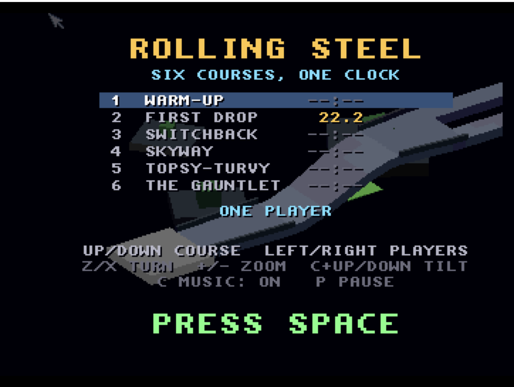
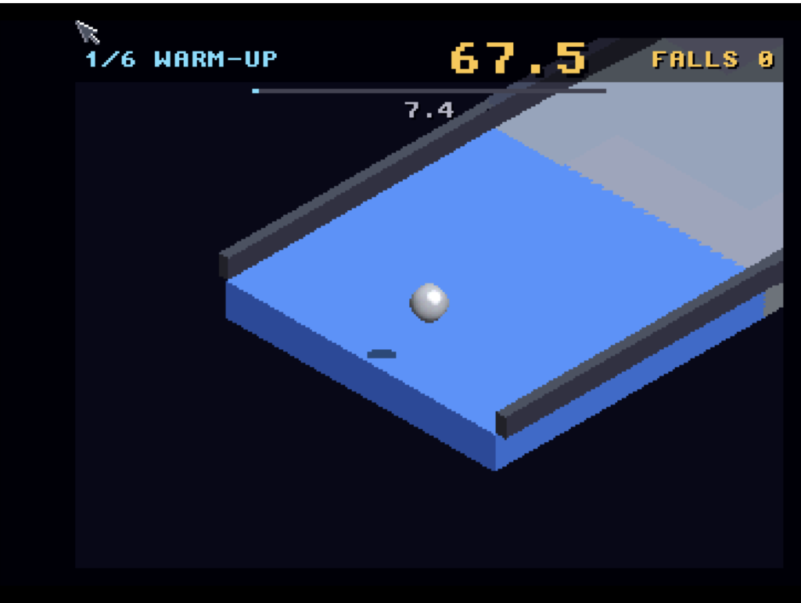

# Rolling Steel
**Platform:** Classic Amiga (68k, AGA A1200/A4000 class) · **Source:** `examples/rolling_steel/` · **Type:** game

A marble-racing game over six 3D courses against one clock, ported from a 3DO original: the classic 68k build (`main_68k.c`, `make ARCH=m68k`) runs the 3DO game code and renderer unchanged, drawing the faces with a CPU software rasteriser with a depth buffer (`glcels_soft.c` on `softcel.c`) in integer maths, so it needs no FPU or 3D library. The 15-bit frame goes to an RTG window/screen or to a 320x256 8-bitplane AGA screen with a fitted 256-colour palette and chunky-to-planar conversion, and the 3DO sound code plays on Paula directly. Under DevBench it registers as bridge client `ROLL`, exposing `state`, `level`, `time_left`, `falls`, `fps10`, `quads` and `prims`, the hooks `press`/`press2` (hold a pad button) and `quit`, and it logs an fps and per-frame timing line (logic/draw/HUD+blit ms) over the bridge.

## Title screen

"ROLLING STEEL / SIX COURSES, ONE CLOCK" with the course list (1 WARM-UP, 2 FIRST DROP, 3 SWITCHBACK, 4 SKYWAY, 5 TOPSY-TURVY, 6 THE GAUNTLET), ONE PLAYER, key help and PRESS SPACE, over a 3D track rendered behind. Launched as `Dropbox:Dev/rolling_steel/rolling_steel_68k` with its `data/` folder beside it.

## Gameplay

Course 1/6, WARM-UP: the silver marble rolls along a grey track with dark raised edges curving away, a dark block structure at top right; the HUD shows the timer at 64.3, FALLS 0, a progress bar and a split of 10.6.

## Course start

The start of the course: the marble on a blue start platform with rails, timer 67.5, split 7.4.

**Controls:** Player 1: arrows (or keypad 8/4/6/2) push the marble, Z / X turn the view, = / - zoom, C + up/down tilt, P pause, Space start. Player 2: W A S D, Q / E, Tab / 1. On the title, up/down picks the starting course. F or F10 switches window / full screen (RTG); Esc quits. Joystick in port 1 also works (fire = start). Usage: `rolling_steel_68k [SCALE=n] [FULLSCREEN] [AGA]`.
