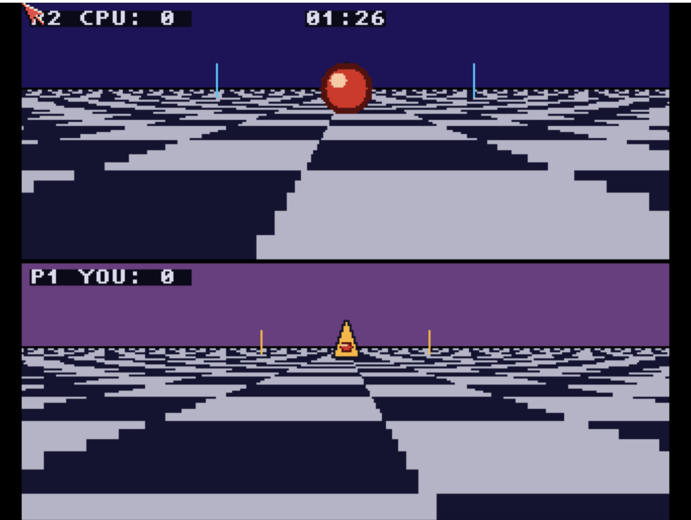

# Rotoball
**Platform:** Classic Amiga (68k, AGA A1200/A4000 class) · **Source:** `examples/rotoball/` · **Type:** game

A split-screen futuristic ball sport in the style of Ballblazer: two skimmers on a checkered grid pitch, the top pane showing the CPU opponent's view and the bottom pane the human player's, each skimmer auto-facing the ball. It opens a 320x256, 5-bitplane double-buffered screen (`AllocScreenBuffer`), renders both panes in 16.16 fixed point (`pitch.c`), and plays synthesised clang/ping samples through audio.device; a match runs 90 seconds, goals are worth 1-3 points depending on how far out the carrier was, and tackles transfer the ball on contact. With DevBench it registers as `rotoball` and exposes `frame_count`, `running`, `p1_score`, `p2_score`, `time_left`, the skimmer positions `p1_x`/`p1_z`/`p2_x`/`p2_z`, `carrier` and `tackle_cd`, logging goals and tackles via `AB_I`.

## Screenshots

Top pane (CPU view): perspective checkerboard pitch, the big red ball close to the camera, two cyan goal posts on the horizon and the HUD "P2 CPU: 0 *BALL* 01:25" (the `*BALL*` marks the CPU as carrier). Bottom pane ("P1 YOU: 0"): the opponent's orange cone craft ahead between orange goal posts under a purple sky.

An earlier frame of the same match, with the ball farther from the camera and the timer at 01:26.

**Controls:** W / S forward / back, A / D strafe left / right, Esc quits.
