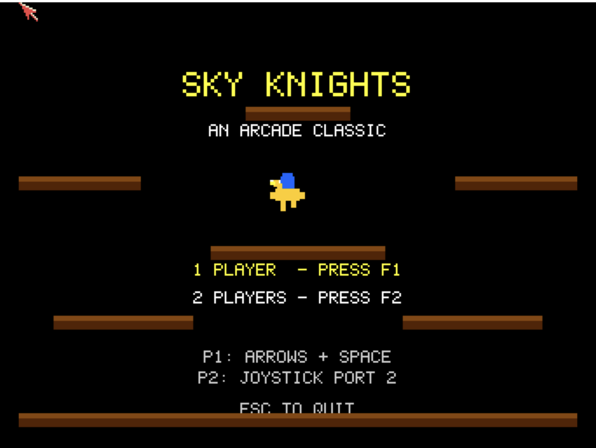

# Sky Knights
**Platform:** Classic Amiga (68k, AGA A1200/A4000 class) · **Source:** `examples/sky_knights/` · **Type:** game

Aerial jousting on winged mounts for one or two players: strike opponents from above and grab the pods downed foes drop before they hatch. It runs on a 16-colour (4-bitplane) custom screen, double-buffered with `ChangeScreenBuffer`, and plays its sound effects and background melody by writing Paula's registers directly, with the flap and smash samples loaded from `flap.raw` and `smash.raw`. Under DevBench it registers as the `sky_knights` bridge client, exposing `score_p1`, `score_p2`, `wave` and `state` as variables plus `reset` and `status` hooks, and logs start-up and shutdown with `AB_I`.

## Title screen

The "SKY KNIGHTS / AN ARCADE CLASSIC" title, with a yellow mount and blue rider standing on brick ledges, the player-count options (1 PLAYER F1, 2 PLAYERS F2) and the control assignments (P1 arrows + Space, P2 joystick in port 2).

## Gameplay

Wave 1: the player's yellow bird and blue knight on the right, facing three orange enemy riders in red helmets perched on brown floating ledges above a sandy floor. Score 0000000, WAVE 1.

**Controls:** P1: cursor keys / A,D move, up / W / Space flap. P2: joystick in port 2, up or fire flaps. F1 or 1: one player, F2 or 2: two players. Esc: quit.
