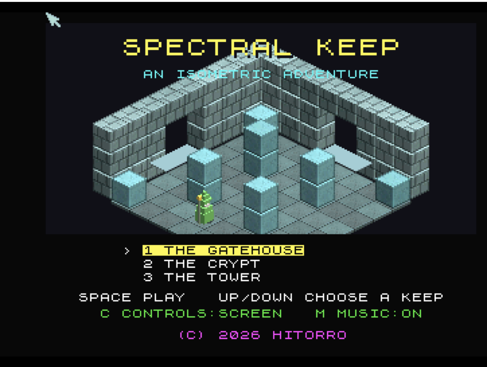

# Spectral Keep
**Platform:** Classic Amiga (68k, AGA A1200/A4000 class) · **Source:** `examples/spectral_keep/` · **Type:** game

An isometric flip-screen adventure in the style of Knight Lore and Head over Heels: three keeps and 24 rooms, where you carry relics to the throne while avoiding guards, hounds, ghosts, bouncers and spikes. The 68k build (`main_68k.c`, `amiga68k.c`) runs the 3DO version's integer-only game code and its software room composer (`scene.c`, in 15-bit RGB), shown on an RTG window/screen or a 320x256 8-bitplane AGA screen via chunky-to-planar, with the 3DO sound code on Paula. Under DevBench it registers as bridge client `KEEP`, exposing `state`, `lives`, `relics`, `keys`, `room`, player position `px`/`py`/`pz`, `fps10` and `cels`, plus hooks `press`, `hold` (hold a pad button for N frames) and `quit`, and logs fps and per-frame logic/draw/blit timings.

## Title screen

"SPECTRAL KEEP / AN ISOMETRIC ADVENTURE" over an isometric stone room (grey-blue brick walls, cyan-topped stone blocks, a green robed figure), with the keep menu 1 THE GATEHOUSE (selected), 2 THE CRYPT, 3 THE TOWER, SPACE PLAY, C CONTROLS: SCREEN, M MUSIC: ON. Launched as `Dropbox:Dev/spectral_keep/spectral_keep_68k`.

## Gameplay

Room THE GATE in THE GATEHOUSE (ROOM 1/6): the white player figure walks at the front of the room while the green robed figure stands among the pillars; the HUD shows 4 hearts, relics 0/3 and keys 0.

**Controls:** arrows / WASD / keypad walk, Space or Return jumps, P pauses, Esc quits. Title: up/down chooses a keep, Space starts, M music, C controls (screen/grid directions), Q+E together tours every room. F or F10 switches window / full screen (RTG). Joystick in port 1 (fire = start / jump). Usage: `spectral_keep_68k [SCALE=n] [FULLSCREEN] [AGA]`.
