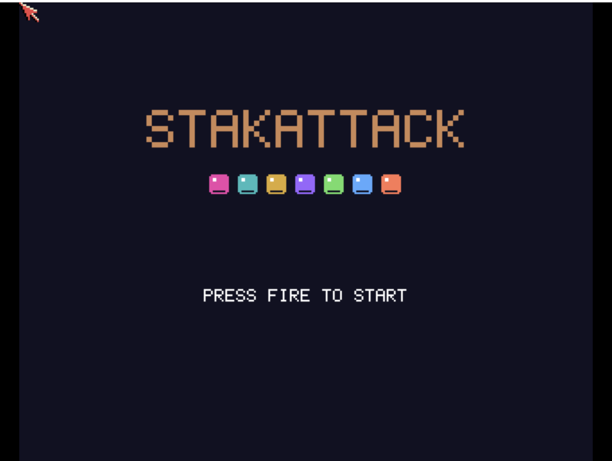

# StakAttack
**Platform:** Classic Amiga (68k, AGA A1200/A4000 class) · **Source:** `examples/stakattack/` · **Type:** game

A colourful falling-block puzzle in a 12-wide well, with original ProTracker music (`stakattack.mod`) played through ptplayer. It renders to a double-buffered 320x256, 16-colour screen (`ChangeScreenBuffer`). It registers as `stakattack` with live `score`, `lines` and `level` variables and a `reset` hook.

## Title screen

The "STAKATTACK" logo above a row of seven coloured block pieces and PRESS FIRE TO START.

## Gameplay

The 12-wide well holds a stack of coloured gem-like blocks while a green S/Z piece falls at the top with grey ghost dots marking where it will land. The side panel shows POINTS 234, ROWS 0, STAGE 1 and a pink I piece COMING UP.

**Controls:** Cursor keys / WASD: move, up / W: rotate, down / S: soft drop · Space: hard drop (start on the title) · Return, Alt or P: start / pause · Joystick: move and rotate, fire: start · Esc: quit
