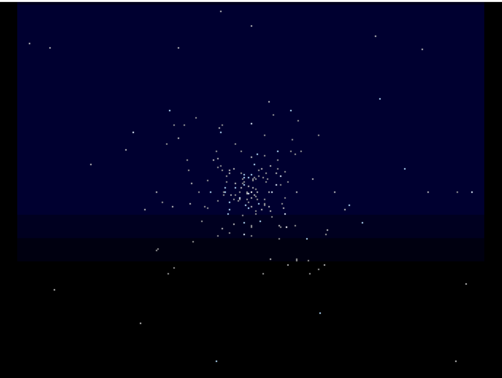

# Starfield
**Platform:** Classic Amiga (68k, AGA A1200/A4000 class) · **Source:** `examples/starfield/` · **Type:** demo

A hardware-banging starfield written mostly in 68k assembly (`starfield.asm`): stars radiate from the screen centre on a 320x256, 3-bitplane PAL screen, the Copper draws the gradient background, the Blitter clears the screen, and a starship silhouette crosses periodically. A C stub (`startup.c`) takes over the system (`LoadView(NULL)`, `OwnBlitter`, `Forbid`), loads and plays `starfield.mod` through ptplayer, and reads the keyboard for the asm side. It registers with the bridge as `starfield` only for logging (chip-memory address, MOD load, frame count at exit): the interactive bridge is disabled during the takeover.

## With starship

White stars stream from a central point across a dark blue/black field while a white silhouette starship (saucer section and nacelles) passes lower left.

## Starfield

The starfield alone. Because the demo takes over the machine, the bridge stopped answering while it ran and Esc could not be delivered remotely, so the emulator had to be restarted to leave it.

**Controls:** cursor keys / WASD steer the view; Esc or left mouse button quits.
