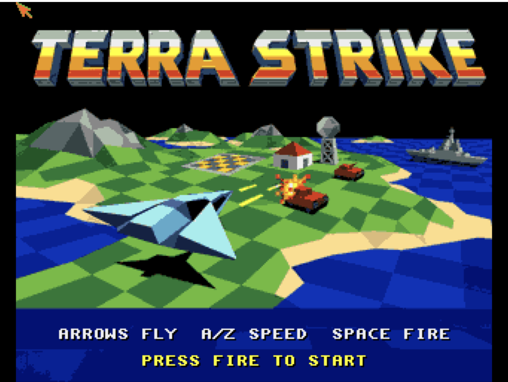
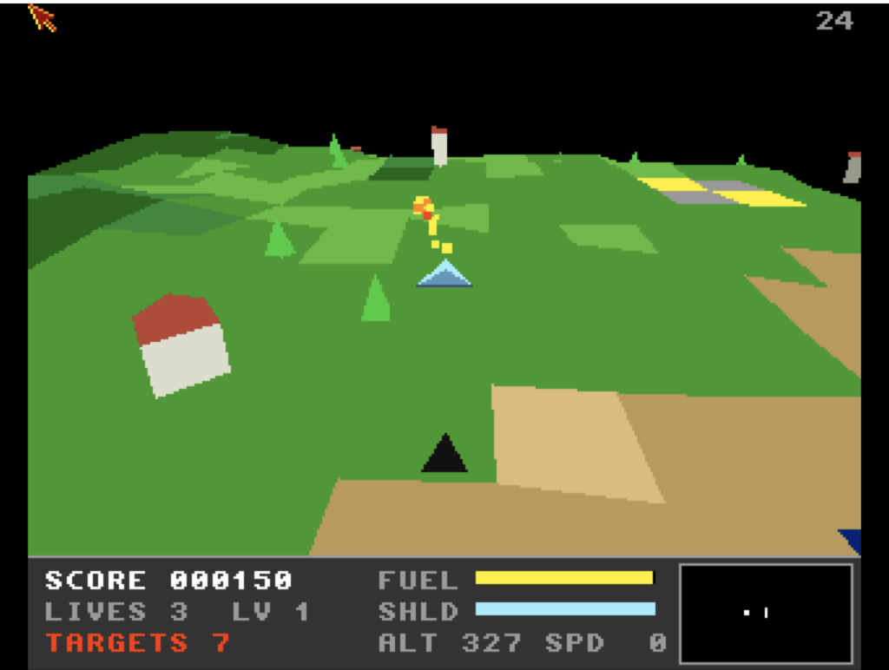
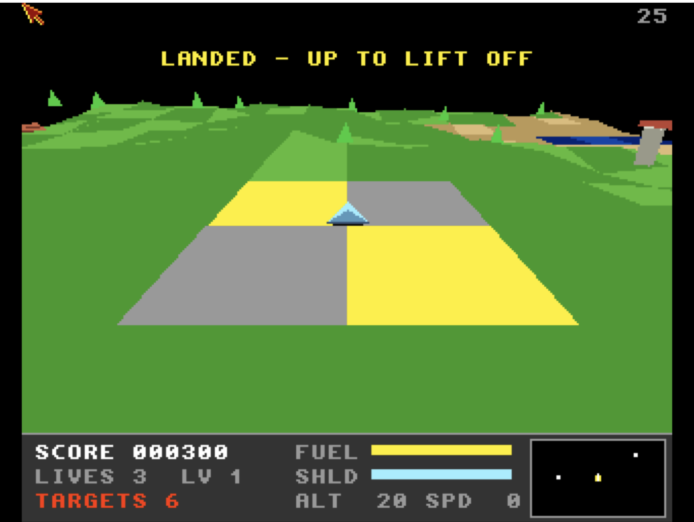

# Terra Strike
**Platform:** Classic Amiga (68k, AGA A1200/A4000 class) · **Source:** `examples/terra_strike/` · **Type:** game

A Zarch / Carrier Command style landscape shooter: lift off from the landing pad, fly over a wrapping fractal island destroying tanks, buildings and ships, and land on the pad again to refuel and repair. The terrain is a 64x64 diamond-square heightmap on a torus; models and the 15x15 tiles around the view are transformed in 16.16 fixed point, sorted into 256 depth buckets and filled by a CPU span filler that writes the five bitplanes directly (32 colours, 320x256 PAL, double-buffered with `ChangeScreenBuffer` and locked to 25 fps), with `terra_strike.mod` on two Paula channels via ptplayer and effects on the other two. It was built test-first against DevBench: 67 unit tests run on the host, on the Amiga (`terra_strike_test`) and in-game via the `selftest` hook, and the `terra_strike` bridge client exposes state, profiling and tuning variables (`score`, `fuel`, `fps`, `polys`, `us_draw`, `god_mode`, `gravity` and more), hooks (`scene`, `spawn`, `start`, `clear`, `regen`, `status`, `title`) and the terrain as a `heightmap` memory region, driven by an end-to-end test (`tests/e2e_devbench.py`).

## Title screen

The chrome "TERRA STRIKE" logo over a painted isometric island scene (a jet, tanks, a house, a radar tower, a warship and checkered fields), with "ARROWS FLY A/Z SPEED SPACE FIRE" and PRESS FIRE TO START. The artwork was converted to 32 colours and five bitplanes by `tools/make_title.py`.

## Gameplay

The player's pale-blue delta jet and its black shadow fly over green and tan checkered terrain toward a blue checkered sea, yellow cannon fire striking a target near a grey tower. HUD: SCORE 000050, LIVES 3, LV 1, TARGETS 8, fuel and shield bars, ALT 296, SPD 9, a radar box, and a frame-rate counter of 25 top-right.

## Gameplay: tanks scene

Set up with the bridge hook `scene tanks`: farmland with a red-roofed house, pine trees, a grey tower and the yellow and grey landing pad in the distance as the jet fires. SCORE 000150, TARGETS 7.

## Gameplay: landing scene

Set up with the bridge hook `scene landing`: the jet sits on the yellow and grey checkered landing pad with "LANDED - UP TO LIFT OFF" on screen, ALT 20, SPD 0, SCORE 000300, TARGETS 6.

**Controls:** Arrows / joystick: turn, climb / dive (the craft hovers when released). A / Z: throttle up / down. Space / fire: cannon (aims itself at a target within about 22 degrees of the nose). P: pause. Return / F1: start. Esc: title / quit.
