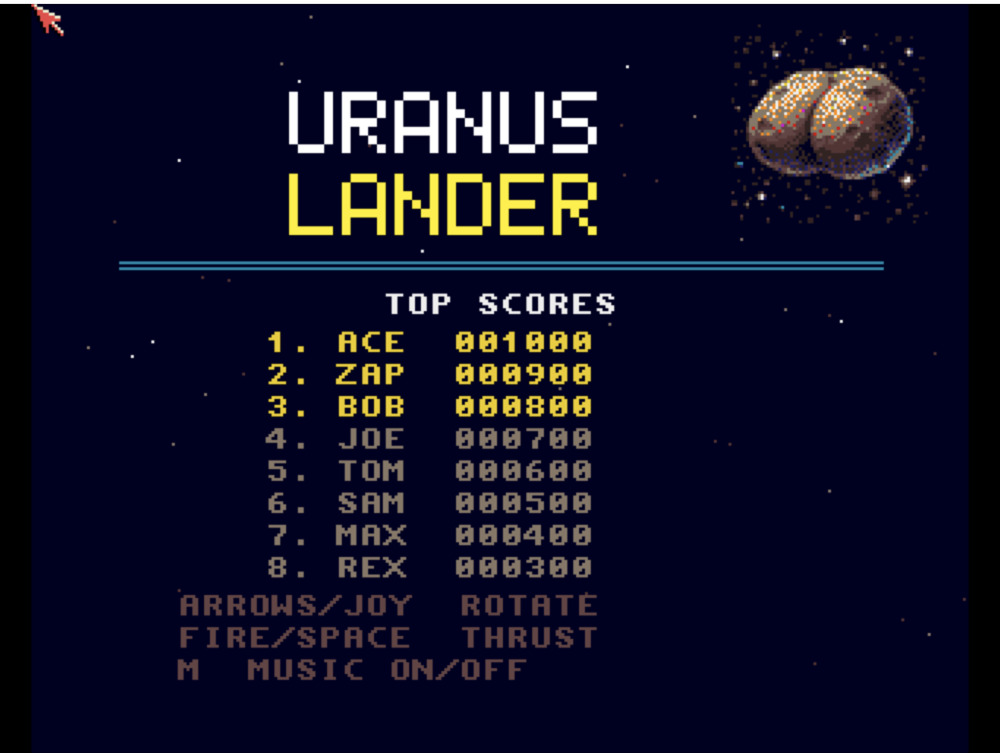

# Uranus Lander
**Platform:** Classic Amiga (68k, AGA A1200/A4000 class) · **Source:** `examples/uranus_lander/` · **Type:** game

A lunar-lander game: rotate and thrust down onto the landing pads of procedurally generated terrain without running out of fuel. It plays ProTracker music (`uranus.mod`) through the ptplayer replayer alongside procedural sound effects, draws on a double-buffered 16-colour screen (`ChangeScreenBuffer`), shows a planet picture converted to planar data by `convert_planet.py`, and saves its high-score table to disk. For tuning through DevBench it registers as `uranus_lander` with live physics variables (`gravity`, `thrust`, `turn_rate`, `fuel_max`, `safe_vx`, `safe_vy`, `safe_angle`, plus `score`, `level`, `lives`, `start_lives`) and hooks `add_fuel`, `add_life`, `next_level` and `reset`.

## Title screen

The "URANUS / LANDER" logo with a cratered, double-lobed planet picture at the top right, a TOP SCORES table (ACE 001000 down to REX 000300) and control hints: arrows/joystick rotate, fire/space thrust, M music on/off.

## Gameplay

Level 1: the cyan vector lander descends with an orange thrust flame over rocky brown terrain with yellow landing pads marked x1, x1, x2 and x2. The HUD shows the FUEL bar, score 0000000, LVL 1, ALT:73, velocity H:-26 V:76 and three reserve landers.

**Controls:** Cursor left/right, A/D or joystick: rotate · Space, W, cursor up, joystick up or fire: thrust (and start) · High-score entry: up/down change letter, Space or fire: next letter · M: music on/off · Esc: quit
