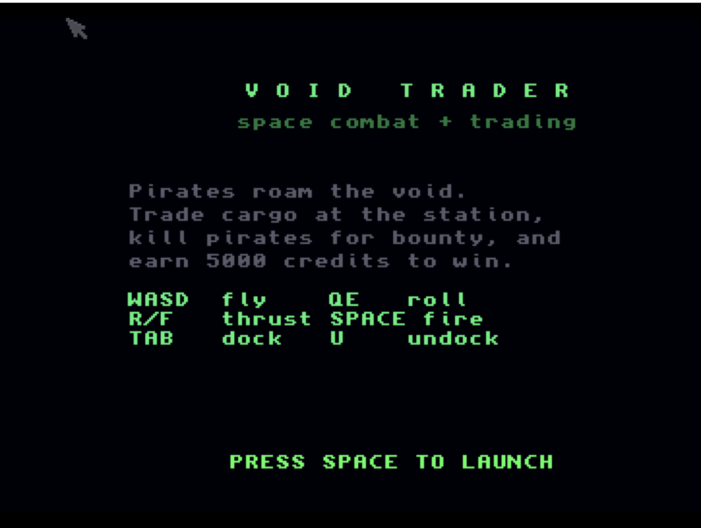

# Void Trader
**Platform:** Classic Amiga (68k, AGA A1200/A4000 class) · **Source:** `examples/void_trader/` · **Type:** game

Space combat and trading in filled 3D: fly with six degrees of freedom, dock at the station to buy and sell, and earn 5000 credits to win. Its 3D engine projects ship models and fills their triangles with graphics.library area fills (`AreaMove`/`AreaDraw`/`AreaEnd`) on a 256-colour AGA screen, double buffered with `ChangeScreenBuffer`, and it has a radar scanner and a generated heavy-metal soundtrack from a Paula-direct MOD-style player. It registers as `void_trader` with live camera variables (`cam_x/y/z`, `cam_yaw`, `cam_pitch`, `cam_roll`), `speed` and `running`.

## Title screen

"VOID TRADER / space combat + trading" with the story text, the key list and PRESS SPACE TO LAUNCH.

## Gameplay

Filled-polygon 3D: a large green cube space station in the centre, two brown octahedral pirates and a white/grey wedge ship to the left, and a green crosshair. The HUD shows SPD 0000, ENGY 0760, FPS 12, CR 100, KILL 0 and an elliptical radar.

**Controls:** W/S pitch, A/D yaw, Q/E roll, R/F thrust · Space: fire / start · Tab: dock (near the station), U: undock · Docked: W/S move the menu, B buy, N sell · Esc: quit (keyboard only)
