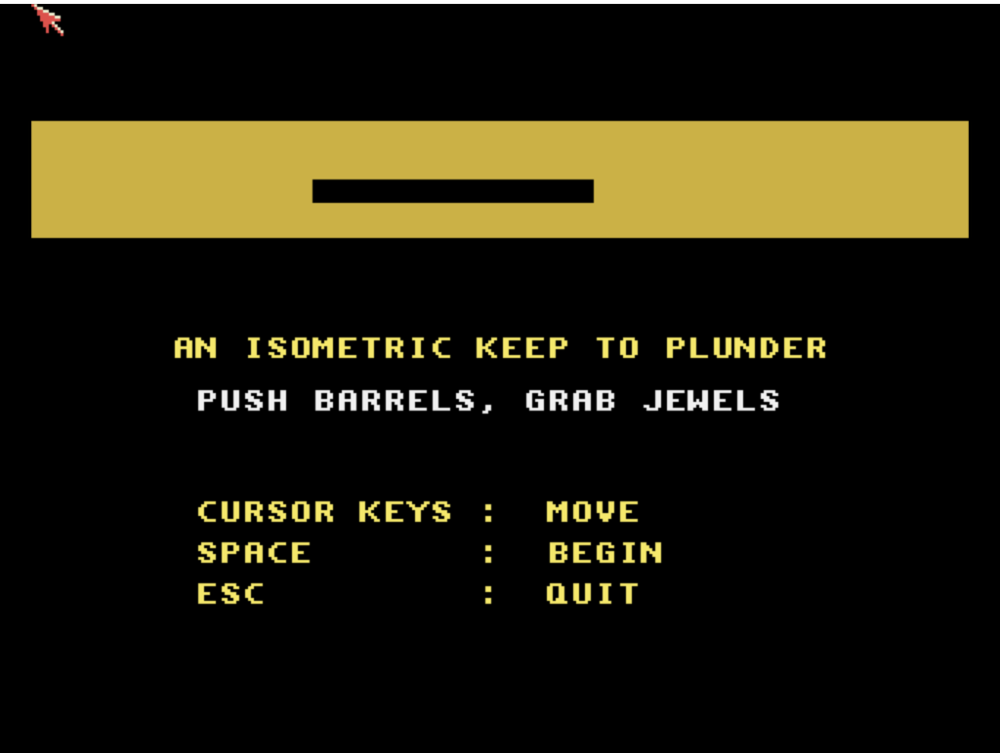

# Warden Keep
**Platform:** Classic Amiga (68k, AGA A1200/A4000 class) · **Source:** `examples/warden_keep/` · **Type:** game

A clean-room isometric room adventure in the Filmation style (Knight Lore, Head over Heels lineage): walk a single 8x8-tile room, push barrels into place and collect the three jewels. Written in C++, it draws on an 8-colour (3-bitplane) screen double-buffered with ScreenBuffer, using a yellow monochrome palette and two back walls in the classic cutaway view; movement is tile-locked, one step per key press. It registers with the bridge as `warden-keep` and exposes `mode`, `score` and `jewels_left`. No sound.

## Title screen

A gold banner whose name text renders as a solid black bar, above "AN ISOMETRIC KEEP TO PLUNDER / PUSH BARRELS, GRAB JEWELS" and the keys (cursor keys move, Space begin, Esc quit).

## Gameplay

The isometric room: yellow stone walls and floor tiles, yellow barrels and crates, the red-and-white player figure, small gold dots and a blue exit pad at the front. HUD: SCORE 000000, JEWELS 3.

**Controls:** Cursor keys, WASD, IJKL or numpad 8/4/6/2: step one tile (held keys auto-repeat). Space, Return or Enter: start / back. Esc: quit. Keyboard only.
