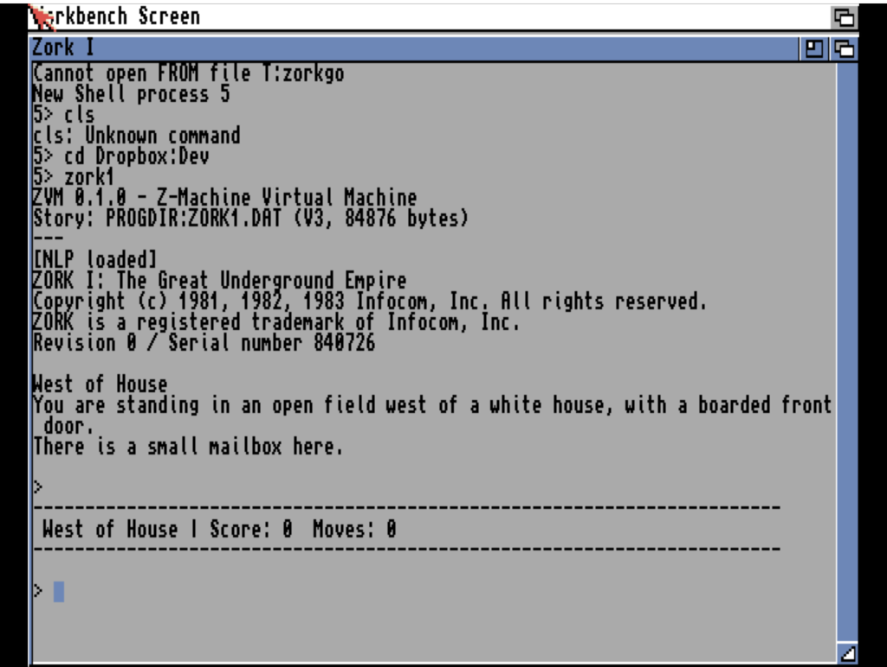

# Zork I (ZVM)
**Platform:** Classic Amiga (68k, AGA A1200/A4000 class) · **Source:** deployed binary `zork1` (ZVM Z-machine interpreter), not in this repo · **Type:** game

Infocom's Zork I running under ZVM 0.1.0, a Z-machine interpreter, from an AmigaDOS shell window. No source for the interpreter is in this repository; only the deployed binary `Dropbox:Dev/zork1` (with `ZORK1.DAT` beside it) and a `Dropbox:Dev/zvm/` folder holding `config/rewrite_rules.txt` and `synonyms.txt`. On screen the interpreter reports an "[NLP loaded]" layer that rewrites typed commands before the game parser sees them; it does not register with the bridge as far as could be observed, so it was driven by typing into a CON: shell.

## Title screen

After `cd Dropbox:Dev` and `zork1`: "ZVM 0.1.0 - Z-Machine Virtual Machine", "Story: PROGDIR:ZORK1.DAT (V3, 84876 bytes)", "[NLP loaded]", the Infocom copyright and revision/serial line (serial 840726), the "West of House" opening text, and a status bar "West of House | Score: 0 Moves: 0".

## Gameplay

After open mailbox / take leaflet / read leaflet: "> go north" is echoed with "[NLP: go north -> north]" (the interpreter's natural-language rewrite), then North of House, "> east", and Behind House (with the window slightly ajar), with a status bar after each move ending at "Behind House | Score: 0 Moves: 5".

**Controls:** type commands at the `>` prompt (e.g. `open mailbox`, `go north`, `east`).
