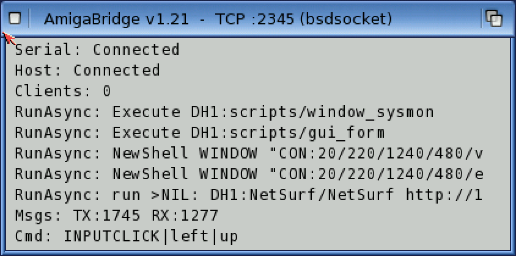

# AmigaBridge (PPC daemon)
**Platform:** AmigaOS 4.1 Final Edition (PowerPC, QEMU sam460ex) · **Source:** `amiga-bridge/` in this repo · **Type:** app

The Amiga-side half of DevBench: a resident daemon that every app links to through `libbridge` (`ab_init`, `ab_log`, `ab_register_var`, `ab_register_hook`, …) over Exec MsgPorts. It relays everything to the host over a line-based, pipe-delimited protocol. One source tree builds both arches: the Makefile splits `DAEMON_SRCS_PORTABLE` from 68k-only parts such as the crash handler, SnoopDos-style patching and the debugger, which PPC replaces with `arch_stubs_ppc.c`. On OS4 it speaks TCP over bsdsocket.library on port 2345, which QEMU forwards to the host as :2347. DevBench (web UI + MCP on :3000) uses it for launching programs, running DOS commands, pushing files with CRC32 checks, reading and writing variables, calling hooks, and injecting keyboard and mouse input. That is how every other screenshot in this set was produced. It starts automatically from `S:User-Startup` (`Run >NIL: DH1:amiga-bridge`).

## On the Workbench

The AmigaOS 4.1 Final Edition Workbench with the AmigaBridge v1.21 status window at top left ("TCP :2345 (bsdsocket)", serial/host connected, 0 clients). Its log shows commands DevBench just sent: a NewShell launch, `Execute DH1:scripts/planner`, and the hello_world client disconnecting.

## Status window close-up

A 2× crop of the status window after a session of remote launches: the run of `RunAsync` launches (Python demos, NetSurf, Shell windows), message counters (TX:1745 RX:1277) and the last command received, an `INPUTCLICK` from the host.
