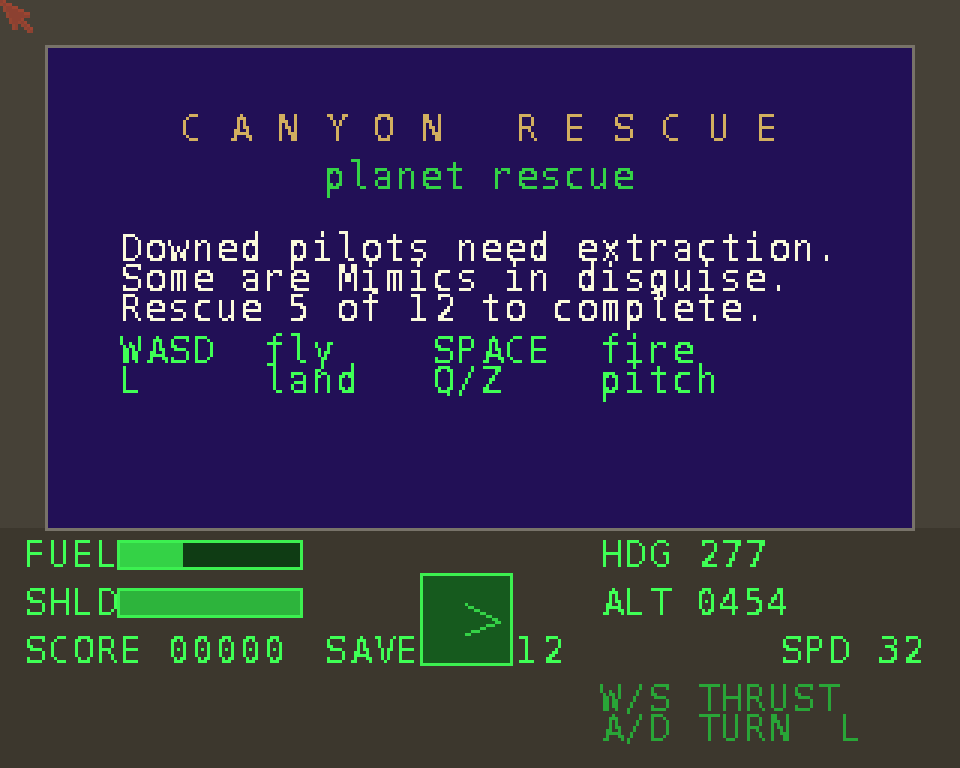

# Canyon Rescue
**Platform:** AmigaOS 4.1 Final Edition (PowerPC, QEMU sam460ex) · **Source:** `examples/canyon_rescue` (amiga_games submodule) · **Type:** game

A rescue flight sim. You fly low over voxel-rendered fractal terrain and pick up downed pilots, but some of them are Mimics in disguise. Rescue 5 of the 12 to win. It is C++ written for the classic 68k/AGA path, and the same source builds for PPC with `scripts/build-example-ppc.sh`. OS4 has no Paula, so the PPC build replaces the music player with a no-op stub (`arch_audio_stub_ppc.cpp`). Through the bridge client library the game logs heartbeats (frame, fps, yaw, speed) to DevBench and exposes variables such as `fuel`, `shield`, `mode` and `force_restart`. These shots used `force_restart` to skip the title screen, because at this frame rate the title drops into the attract demo in under a second.

## Title screen

The mission briefing over the terrain view, with the control legend (WASD fly, SPACE fire, L land, Q/Z pitch) above the cockpit HUD.

## Gameplay

In flight on a 301° heading at altitude 460. The white markers on the ridge are downed pilots waiting for pickup. The HUD shows fuel and shield bars, score, the rescued count and a compass.
