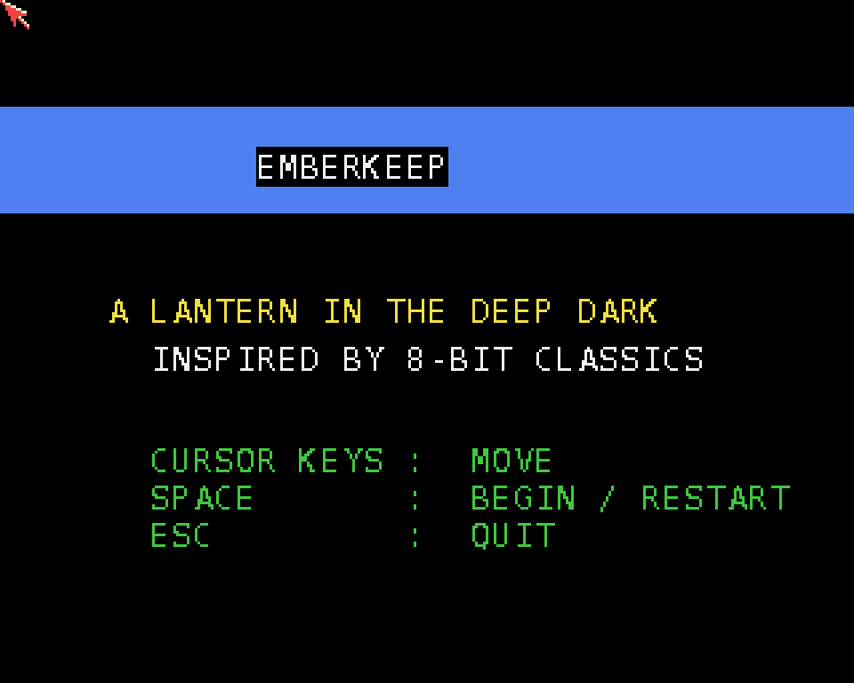

# Emberkeep
**Platform:** AmigaOS 4.1 Final Edition (PowerPC, QEMU sam460ex) · **Source:** `examples/emberkeep` (amiga_games submodule) · **Type:** game

A clean-room top-down cavern explorer built around a "lantern in the deep dark": you carry a small burning lantern that lights only a tight area around you. Everything else stays pitch black until it enters your light, and you refill the oil from flasks while collecting runes to open the exit portal. The tile and sprite art are original (`tilesheet_data.cpp`). The PPC binary was already built in `examples/emberkeep/`; for this capture it was pushed to the guest's `RAM:` over the bridge (`amiga_push_file`, CRC32-verified) and launched from there, without touching the dev HDF.

## Title screen

The title card ("A lantern in the deep dark") with the controls: cursor keys move, SPACE begins or restarts, ESC quits.

## Gameplay

The explorer in the first keep. Only the lantern's small pool of light shows the nearby red and grey stone walls and the floor; the rest of the cavern is dark. The status bar shows the score, the orange oil gauge, level 1, runes 0/3 and 3 lives.
