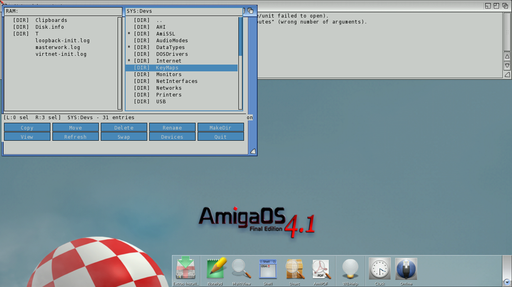

# Masterwork
**Platform:** AmigaOS 4.1 Final Edition (PowerPC, QEMU sam460ex) · **Source:** `examples/masterwork` (amiga_games submodule) · **Type:** app

A two-pane, Directory Opus-style file manager written against plain Intuition/graphics (the button bar is drawn, not gadtools). Keyboard: Space selects, Enter descends or views, Tab switches pane. Ten actions sit on the button bar: Copy, Move, Delete, Rename, MakeDir, View, Refresh, Swap, Devices and Quit. It registers with the bridge and exposes `running` and `active_pane` as variables. For this capture it was driven entirely by injected keys and mouse clicks from DevBench.

## Startup

Masterwork on the Workbench with RAM: in the left pane and SYS: in the right, the status/help line, and the 2×5 action bar.

## Browsing and multi-select

The right pane descended into SYS:Devs (31 entries), with three directories tagged `*` (AmiSSL, DataTypes, Internet) and the cursor on KeyMaps. The status line shows "R:3 sel".
