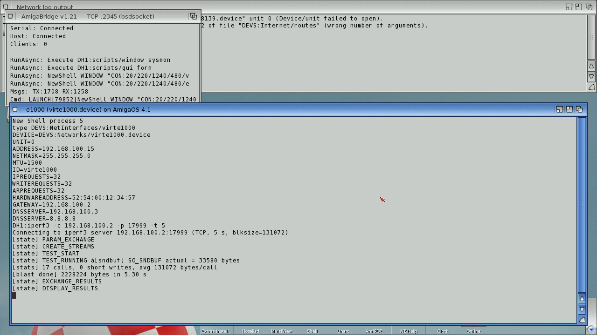
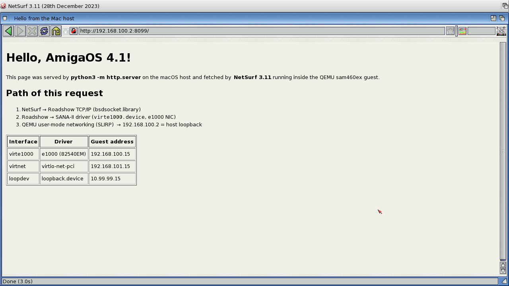

# Networking on the OS4 guest: SANA-II drivers
**Platform:** AmigaOS 4.1 Final Edition (PowerPC, QEMU sam460ex) · **Source:** `~/code/claude_world/virtio_net` ([virtnet-amigaos4](https://github.com/geekychris/virtnet-amigaos4)), `~/code/claude_world/loopback_amigaos4` ([loopback-amigaos4](https://github.com/geekychris/loopback-amigaos4)), `~/code/claude_world/virte1000` ([amiga-e1000-driver](https://github.com/geekychris/amiga-e1000-driver)), `~/code/claude_world/rtl8139_re`, `~/code/claude_world/iperf-amigaos4` · **Type:** driver

The QEMU guest runs with two NICs, and Roadshow brings up three interfaces. **virtnet** is `virtnet.device`, a from-scratch SANA-II driver for virtio-net-pci (legacy mode). Its README calls it the first virtio-net driver for OS4; the copy in `DEVS:Networks` is byte-for-byte the size of `virtio_net/build/virtnet.device`. **loopdev** is `loopback.device`, a software-only SANA-II loopback used to measure the Roadshow/SANA-II ceiling. **virte1000** (the e1000 NIC) is the link the AmigaBridge and the host use. Honest note: the `virte1000.device` installed in `DEVS:Networks` (23,348 bytes) is not this repo's `virte1000` build (32,720 bytes); the launch script and the virtio_net README describe it as Bill Borsari's known-working e1000 driver. The `virte1000` repo was Chris's own e1000 effort, and its later phases turned into the virtio-net work. `rtl8139re.device` (a partial RTL8139 re-implementation, TX only, no RX yet) is installed but not shown, because no rtl8139 NIC is attached in the current QEMU setup. Throughput was measured with `iperf-amigaos4`, a small iperf3-protocol client written because upstream iperf3 needs pthreads. It ran against `iperf3 -s` on the Mac host. Every driver and tool here was pushed to the guest and exercised through DevBench's bridge.

## virtio-net: interfaces, config and iperf3 over virtnet.device

`ShowNetStatus INTERFACES` lists all three interfaces Up: loopdev 10.99.99.15, virte1000 192.168.100.15 and virtnet 192.168.101.15. Below it are `DEVS:NetInterfaces/virtnet` and an iperf3 run to the host through the virtio NIC (192.168.101.2). The iperf3 data reached the host: 1 MB in 13.3 s, with long stalls (about 0.6 Mbit/s). That is far below the 25.3 Mbit/s the virtnet README reports from a fresh boot; the iperf-amigaos4 README warns that throughput collapses after repeated runs in one session, and this guest had been up for a while under heavy bridge traffic. ShowNetStatus also shows 0 packets on virtnet even though the QEMU pcap shows the traffic, so the driver evidently doesn't fill in Roadshow's counters.

## e1000: iperf3 over virte1000.device

The e1000 interface config (address, gateway 192.168.100.2, DNS) and an iperf3 run to the host over it: 2,228,224 bytes in 5.30 s, about 3.4 Mbit/s in this session. Both runs end at `DISPLAY_RESULTS` because the Amiga client waits after the results exchange; the host server printed the per-second bitrates.

## A web page fetched over the network

NetSurf 3.11, a third-party browser used here only as a network client, showing a page served by `python3 -m http.server` on the Mac. The request went through Roadshow → the e1000 SANA-II driver → QEMU SLIRP → host, and the host's server logged `GET / 200`.
