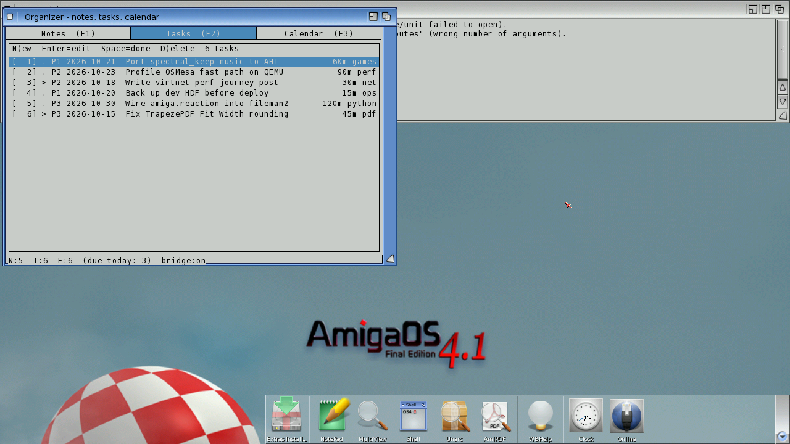
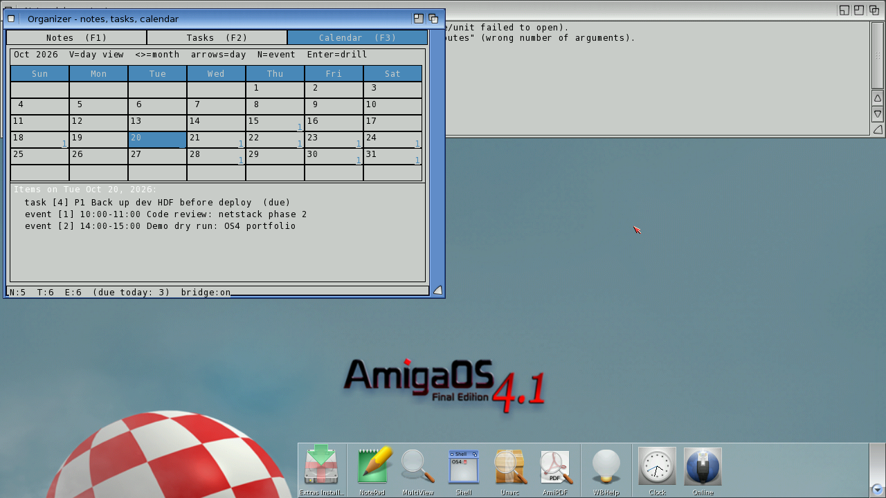

# Organizer
**Platform:** AmigaOS 4.1 Final Edition (PowerPC, QEMU sam460ex) · **Source:** `examples/organizer` (amiga_games submodule) · **Type:** app

A personal notes / tasks / calendar app with three tabs (F1/F2/F3). Data is kept as human-editable pipe-delimited text in `S:organizer/*.txt`. It integrates with the bridge more deeply than most of the examples: hooks (`add_note`, `add_task`, `add_event`, `set_task`, `delete`, `reload`, `test`) let the host script it, and its tables are exposed to the host as memory regions. For these shots, sample data was written into `S:organizer/` over the bridge (the user's own files were backed up and restored afterwards).

## Notes

The Notes tab lists five tagged notes, with the body of the selected "TrapezePDF v1.1 release checklist" note in the lower pane. The status bar reads "N:5 T:6 E:6 (due today: 3) bridge:on".

## Tasks

The Tasks tab: priority (P1–P3), due date, title, effort estimate and tag for each task, with in-progress tasks marked `>`.

## Calendar

The October 2026 month grid with per-day item counts, today (Tue 20) highlighted, and the day's agenda below it: a due task and two timed events.
