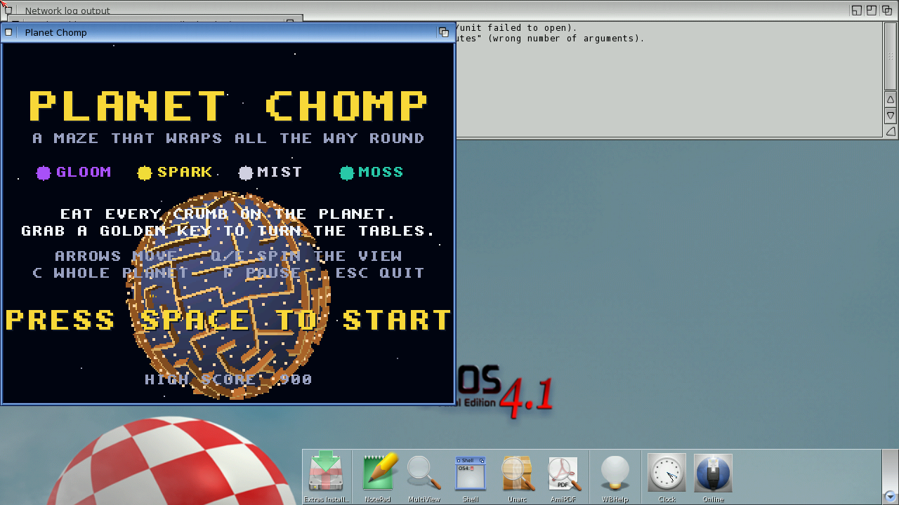

# Planet Chomp
**Platform:** AmigaOS 4.1 Final Edition (PowerPC, QEMU sam460ex) · **Source:** `examples/planet_chomp` (OS4 port); original Unity game at `~/code/claude_world/planet-chomp` · **Type:** game

A maze chase that wraps all the way round a small planet: eat every crumb while four spooks (Gloom, Spark, Mist and Moss) hunt you, and grab a golden key to turn the tables. The OS4 port does real perspective 3D with no 3D hardware. It renders through software Mesa (OSMesa 7.8.2, built by `third_party/mesa-os4`), using the `GL_LESS` + flat-shading fast path and a simplified ring mesh, because QEMU emulates the PPC FPU in software. It needs a ~2 MB `$STACK` cookie. Over the bridge (client name `PLANET`) it reports per-stage GL timings; this run logged about 25 fps (logic 0 ms, GL 35 ms, blit 4 ms per frame).

## Title screen

The title in a Workbench window: the rotating 3D planet maze behind the logo, the four spooks' names and the controls.

## Gameplay

Level 1 in progress: the player (green, centre) on the curved maze surface with its 3D walls and crumbs. The score is 20 with 478 crumbs left, and the radar at bottom right tracks the spooks.
