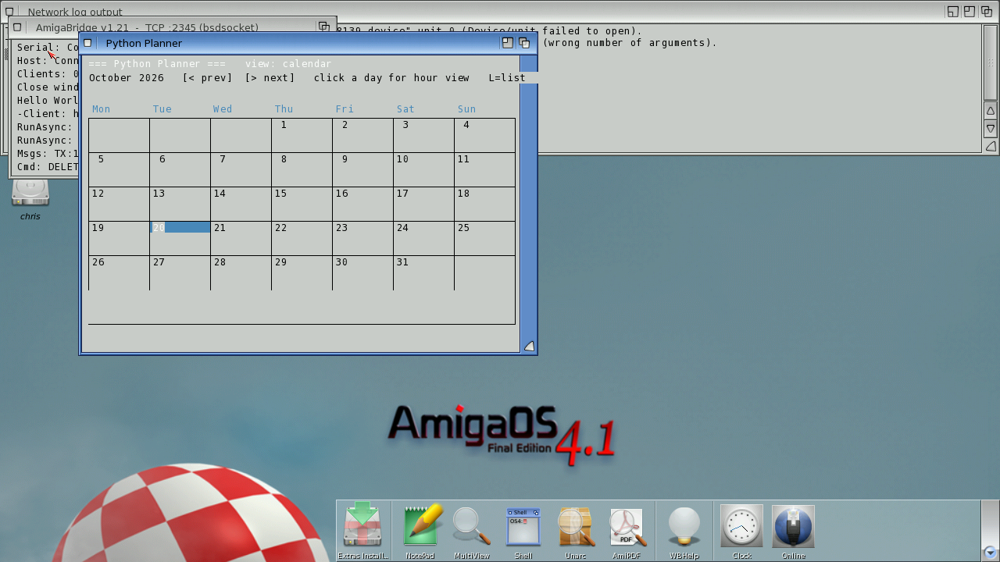
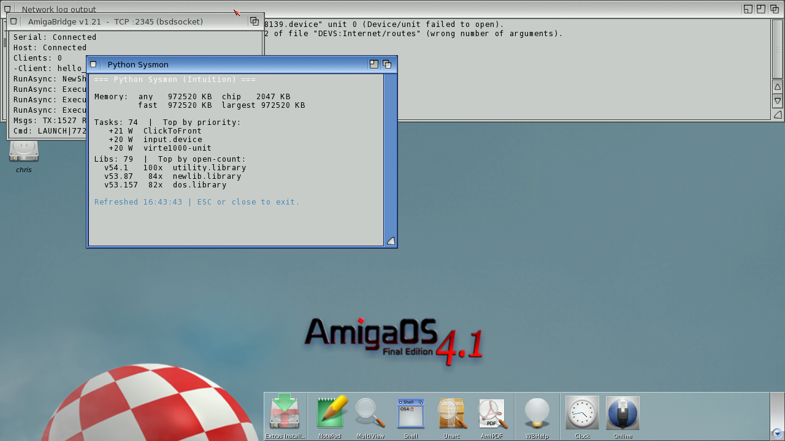
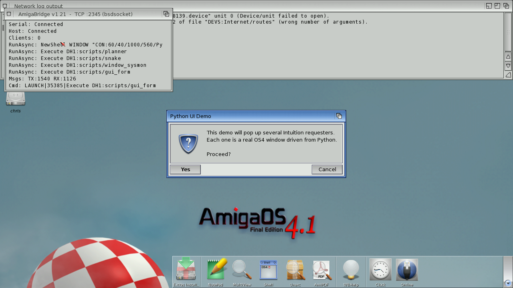
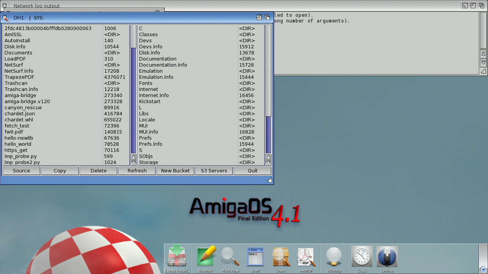
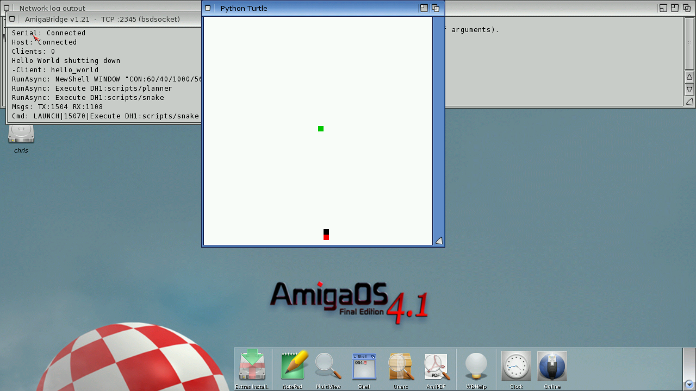

# Python 3.12 for AmigaOS 4
**Platform:** AmigaOS 4.1 Final Edition (PowerPC, QEMU sam460ex) · **Source:** `~/code/claude_world/python-amigaos4` ([github.com/geekychris/python-amigaos4](https://github.com/geekychris/python-amigaos4)) · **Type:** language port

CPython 3.12.7, cross-compiled for AmigaOS 4.1 PPC with the walkero GCC 11 toolchain in Docker, and shipped as a single stripped executable of about 15 MB (`DH1:python-os4`). The guest has no dynamic loader, so the C extensions are built in statically; `sys.builtin_module_names` lists 58 entries, including sockets on bsdsocket.library, threads, SQLite, zlib and a native `_amiga` module. On top of these sits an `amiga.*` package with Intuition, ReAction, turtle, ARexx, pip-style wheel installs and HTTPS via `openssl`. Known limits: native `_ssl` sockets don't work (HTTPS goes through `amiga.https`), and there is no fork/exec. The port was developed using this repo's bridge and MCP tools as its deploy and test harness.

## Python in a Shell

A Shell window running `python-os4 -V`, a one-liner printing `sys.version` ("3.12.7 … [GCC 11.5.0]"), and a script that uses list comprehensions, `json`, an in-memory `sqlite3` table, `zlib`, four `threading` threads, `_amiga.avail_mem()` and `datetime`. All of it ran on the guest.

## Intuition GUI: planner

`examples/planner.py`: a calendar/planner written in Python against native Intuition windows and backed by SQLite, showing October 2026 with today highlighted.

## Intuition GUI: system monitor

`examples/window_sysmon.py`: live memory figures, the top tasks by priority (including the `virte1000-unit` network driver task) and the libraries with the most opens, all read through the native `_amiga` Exec bindings.

## System requester

`examples/gui_form.py` opening a real OS4 requester from Python ("Each one is a real OS4 window driven from Python").

## ReAction file manager

`fileman2.py`: a dual-pane file manager built from ReAction `window.class` and listbrowser gadgets in Python, showing DH1: and SYS:. It is designed with an S3/MinIO pane on one side; S3 wasn't connected for this shot, so both panes are local. The size column truncates long values (TrapezePDF's 43,760,716 bytes shows as 4376071).

## Turtle graphics

The freegames "snake" running on the port's `amiga.turtle` module in an Intuition window: the green food square and the snake at the bottom.
