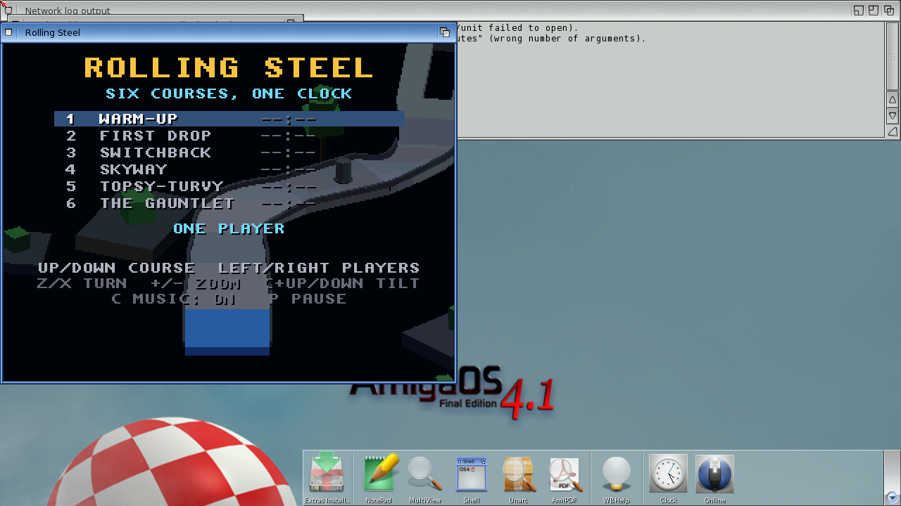

# Rolling Steel
**Platform:** AmigaOS 4.1 Final Edition (PowerPC, QEMU sam460ex) · **Source:** `examples/rolling_steel` (OS4 port); original Unity game at `~/code/claude_world/rolling_steel` · **Type:** game

An isometric roll-the-marble racer in the spirit of the 1984 arcade cabinet: six courses share one clock. Like Planet Chomp, the OS4 build draws 3D through software OSMesa (pre-projected orthographic faces plus a depth buffer). It loads its course data from `PROGDIR:data/`. Over the bridge (client `ROLL`) it reported **46.9 fps** during this capture, with about 231 quads per frame (draw 13 ms, HUD and blit 4 ms).

## Title screen

The course-select screen (Warm-Up, First Drop, Switchback, Skyway, Topsy-Turvy, The Gauntlet), shown over a live 3D view of the course.

## Gameplay

The steel marble rolling along the Warm-Up course past a bollard, with blocky trees on a raised platform. The countdown clock (65.6 s), course progress and falls counter run across the top.
