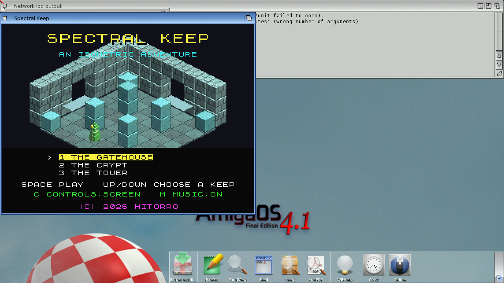

# Spectral Keep
**Platform:** AmigaOS 4.1 Final Edition (PowerPC, QEMU sam460ex) · **Source:** `examples/spectral_keep` (OS4 port); original Unity game at `~/code/claude_world/spectral-keep` · **Type:** game

An isometric flip-screen adventure in the Knight Lore tradition: three keeps and 24 rooms. The OS4 port uses no OpenGL; a software sprite compositor draws the rooms at a steady frame rate. It works around a bug found on the guest, where newlib's `memcpy` silently leaves the last 256 KB uncopied on copies of roughly 300 KB or more. Big buffers are copied with a plain loop instead. It registers with the bridge as `KEEP`.

## Title screen

The title shows a rendered isometric stone room and the keep selector (The Gatehouse, The Crypt, The Tower), with music and control-mode toggles.

## Gameplay

"The Gate", room 1 of 6 in The Gatehouse: the green-robed player among glowing stone blocks, with a skeleton guard on the right. The status bar shows lives, gems (0/3) and keys.
