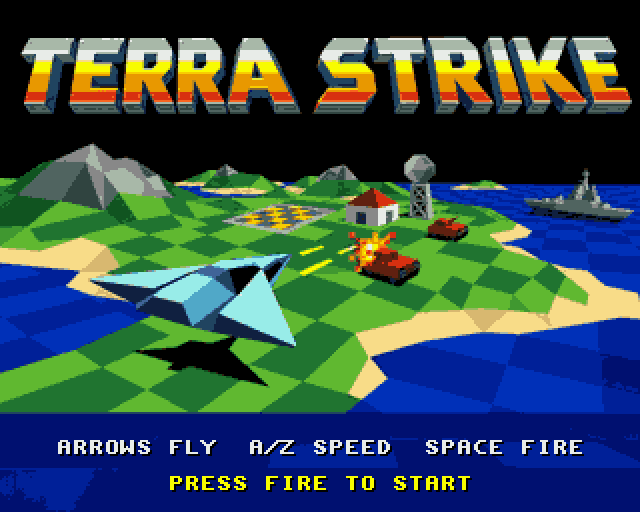
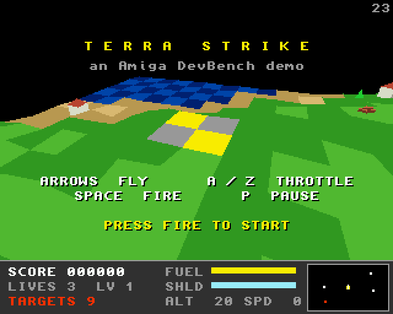
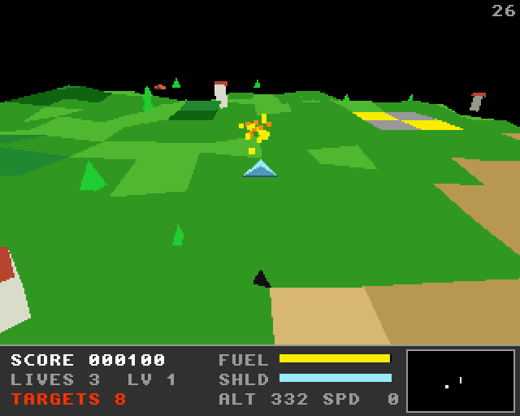
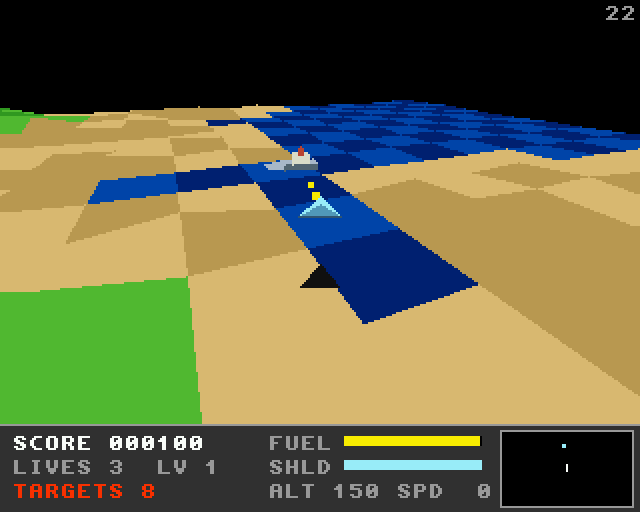
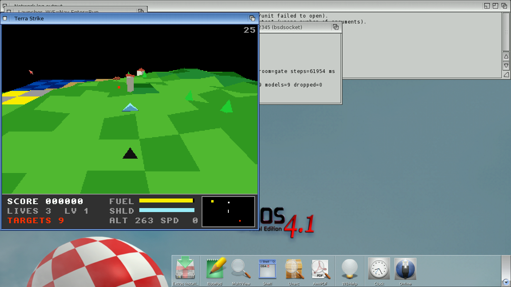
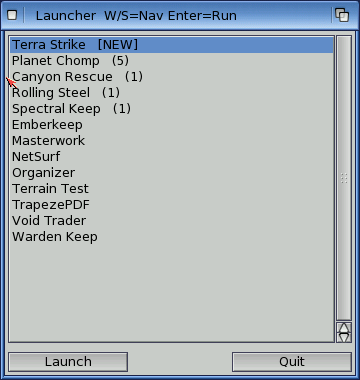

# Terra Strike
**Platform:** AmigaOS 4.1 Final Edition (PowerPC, QEMU sam460ex) · **Source:** `examples/terra_strike` (`main_os4.c`, `make ARCH=ppc`) · **Type:** game

The OS4 port of the [classic Amiga landscape shooter](../../amiga-68k/terra_strike/terra_strike.md): lift off from the landing pad, fly over a wrapping fractal island destroying tanks, buildings and ships, and land on the pad again to refuel and repair. The simulation, renderer, models and the whole bridge interface (client `terra_strike`, with the same vars and hooks) are shared with the 68k version. Instead of writing five bitplanes, the renderer fills a 320x256 buffer of 8-bit pens, which is turned into RGB through the current palette and shown in a Workbench window (`SCALE=n`, default 2) or on a screen of its own (`FULLSCREEN`; F or F10 switches). The text is the same topaz 8, with the glyphs read out of the ROM font. There's no Paula on the sam460ex, so `terra_strike.mod` is played by `modplay.c`, a small Protracker player that mixes in software, and streamed to `ahi.device` along with the synthesised effects. Frames are paced at 25 fps by sleeping on `timer.device`; under QEMU `WaitTOF()` returns hundreds of times a second, and waiting on it starved the bridge daemon. It runs at 24-25 fps, and the in-game `selftest` hook passes all 67 unit tests on PowerPC.

## Title screen

The converted title artwork with its own 32-colour palette, on a full screen of its own (800x600, scaled 2x). After 10 seconds the title switches to the 3D flyover.

## Attract flyover

The camera circles the landing pad with the title, controls and PRESS FIRE TO START drawn over the 3D island in topaz 8. The counter at top right is the frame rate (23).

## Gameplay: tanks scene

Set up with the bridge hook `scene tanks`, the cannon (keys sent through the QEMU monitor) has just destroyed a tank: SCORE 000100, TARGETS 8, at 26 fps.

## Gameplay: sea scene

Set up with `scene sea`: the jet over the beach and the checkered sea, firing at a ship.

## In a window

Without `FULLSCREEN` the game runs in a Workbench window, scaled 2x to 640x512, here at 25 fps over the city scene.

## In the game launcher

`DH1:launcher` lists it from `DH1:launcher.list` as `Terra Strike|DH1:terra_strike/terra_strike FULLSCREEN`, marked [NEW] until it has been run.

**Controls:** Arrows: turn, climb / dive. A / Z: throttle up / down. Space: cannon. P: pause. Return: start. Esc: title / quit. F or F10: window / full screen.
