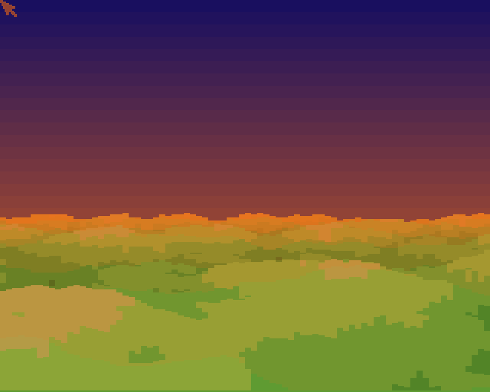

# Terrain Test
**Platform:** AmigaOS 4.1 Final Edition (PowerPC, QEMU sam460ex) · **Source:** `examples/terrain_test` (amiga_games submodule) · **Type:** demo

A one-file voxel landscape flyer with no gameplay. The camera flies itself over a height-mapped terrain, which made it the bench for checking the voxel renderer that Canyon Rescue uses. It streams camera position and FPS heartbeats over the bridge so performance can be measured from the host; this run reported about 12 fps on the QEMU guest.

## Flyover

The voxel terrain under a sunset gradient sky, with height-shaded green and ochre hills.

## Flyover, two seconds later

A later frame from the same automatic flight, after the camera had moved and turned (yaw 360 → 450 in the bridge heartbeat).
