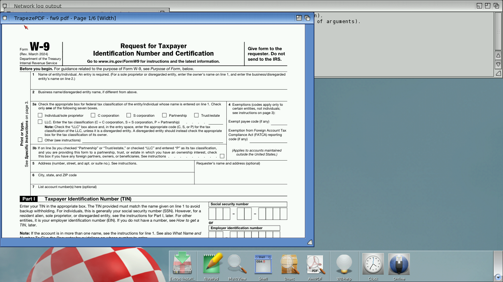
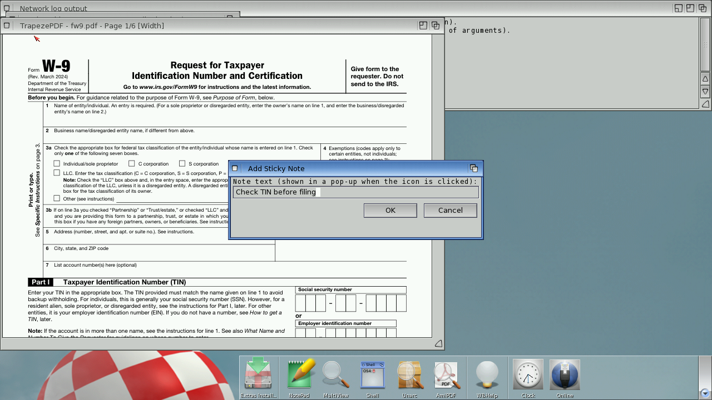
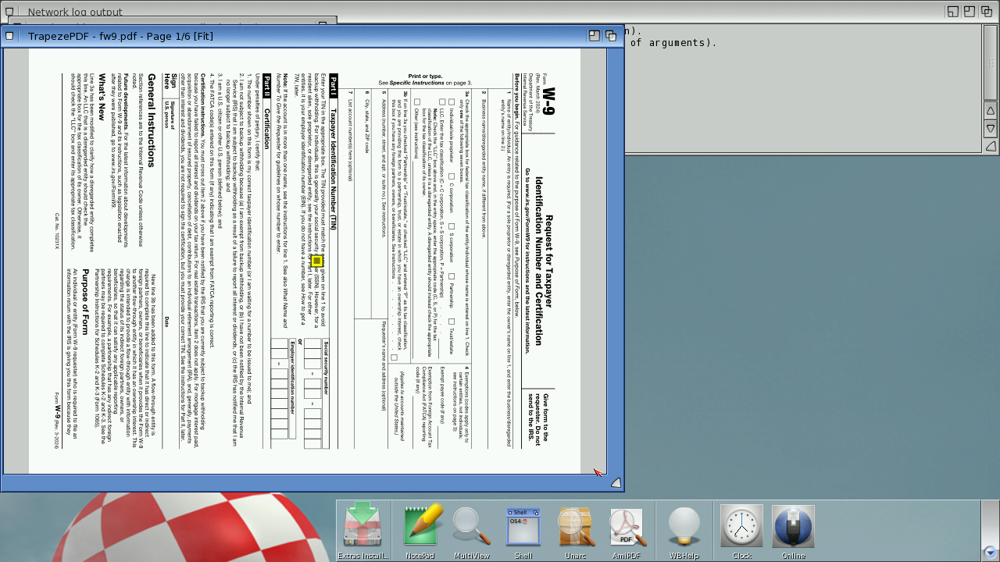

# TrapezePDF
**Platform:** AmigaOS 4.1 Final Edition (PowerPC, QEMU sam460ex) · **Source:** `~/code/claude_world/pdfview-os4` ([github.com/geekychris/TrapezePDF](https://github.com/geekychris/TrapezePDF)) · **Type:** app

A native PDF viewer for AmigaOS 4, built on MuPDF and cross-compiled in Docker into one static PPC ELF of about 44 MB. Licence: AGPL-3.0, to match MuPDF. It is at alpha stage. Beyond viewing and zooming it can open HTTPS URLs (fetched via `openssl s_client`), print to `PRT:` as PostScript, add sticky-note annotations, fill forms, and rotate, delete or extract pages, with Save As persisting the changes. It is deployed and tested through DevBench (`/api/transfer` for the binary, `/api/launch` plus injected Right-Amiga shortcuts to drive the menus).

## Rendered page

DH1:fw9.pdf (IRS Form W-9) opened from the command line and shown at Fit Page. The title bar reads "Page 1/6 [Fit]".

## Fit Width (Right-Amiga + W)

The same page after the Fit Width shortcut: MuPDF re-renders it at window width with crisp, anti-aliased text and form-field boxes.

## Adding a sticky note (Right-Amiga + N)

The modal Add Sticky Note dialog over the document, holding the note text "Check TIN before filing" ready to confirm.

## Rotated page with annotation (Right-Amiga + R)

The page rotated 90° clockwise and refit. The new sticky-note annotation is the yellow icon marker in the middle of the page. The document was closed without saving.
