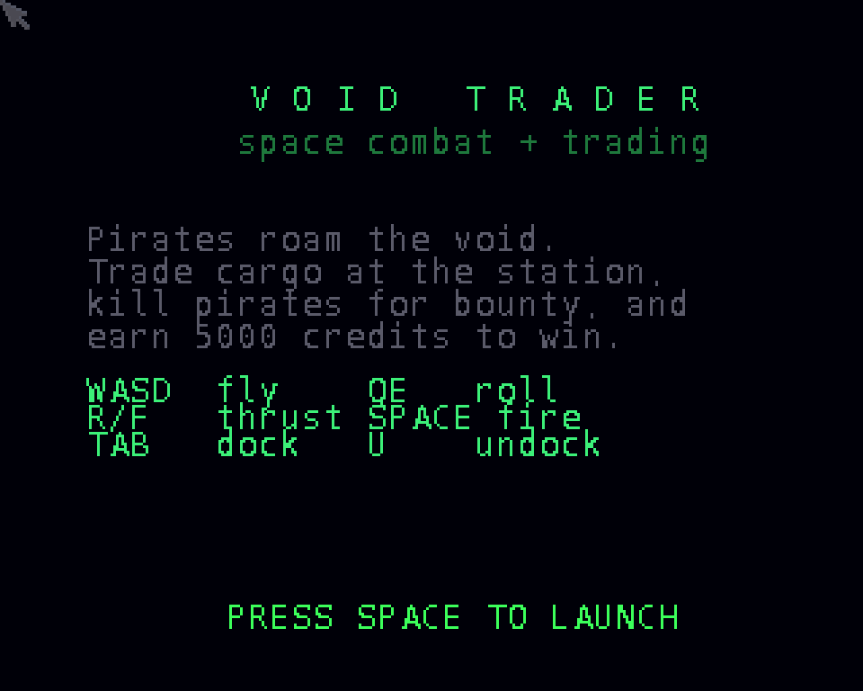

# Void Trader
**Platform:** AmigaOS 4.1 Final Edition (PowerPC, QEMU sam460ex) · **Source:** `examples/void_trader` (amiga_games submodule) · **Type:** game

A 3D space trading and combat game in the spirit of Elite: fly between pirates and a trading station, trade cargo, and collect bounties until you reach 5000 credits. It uses a flat-shaded polygon engine (`engine3d.c`) with a scanner, combat and trade modules. It was written for 68k/AGA and runs natively on PPC; sound is stubbed out there (`arch_audio_stub_ppc.c`, which logs "modplay unavailable"). DevBench launched it and drove the keyboard through the bridge's input injection. It streams camera and FPS heartbeats back to the host.

## Title screen

The title page with the premise and controls (WASD fly, Q/E roll, R/F thrust, SPACE fire, TAB dock, U undock).

## Gameplay

Just after launch: the green cube-shaped trading station sits ahead, with a pirate raider on each side. The HUD shows speed, energy, credits and kills, and the elliptical scanner shows the raiders as red blips.
