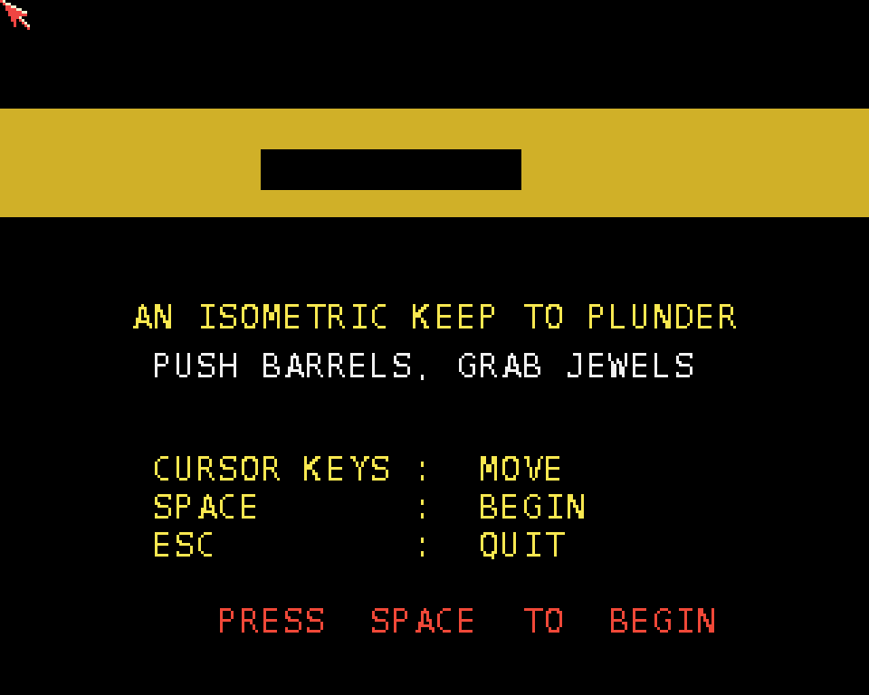

# Warden Keep
**Platform:** AmigaOS 4.1 Final Edition (PowerPC, QEMU sam460ex) · **Source:** `examples/warden_keep` (amiga_games submodule) · **Type:** game

A clean-room isometric "Filmation-style" room puzzle (Fairlight, Knight Lore, Head over Heels lineage): walk an 8×8 stone room tile by tile, push barrels into place and collect the three jewels. It uses a yellow monochrome palette and the classic two-back-wall cutaway. As with Emberkeep, the existing PPC binary from `examples/warden_keep/` was pushed to `RAM:` over the bridge and run from there. One visible defect on OS4: the title banner's game name renders as an empty black box.

## Title screen

The title page ("An isometric keep to plunder. Push barrels, grab jewels"). The game name in the gold banner doesn't render on this build; it shows as a black box.

## Gameplay

The isometric room with its two cutaway back walls, the red-and-white player figure, yellow barrel blocks and a jewel on the floor. The HUD shows the score and 3 jewels remaining.
