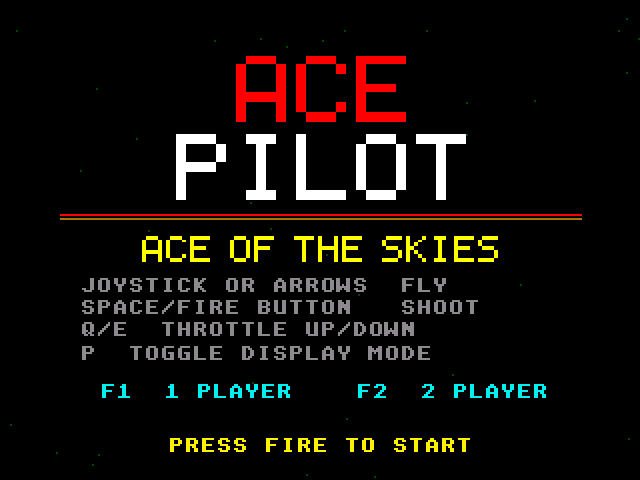
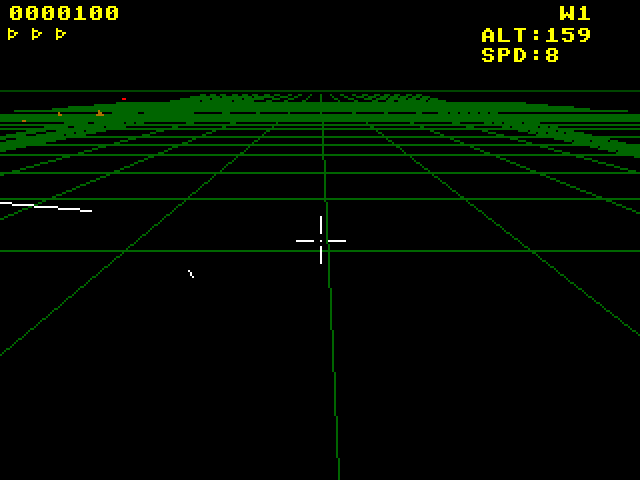

# Ace Pilot
**Platform:** Atari Falcon030 (Hatari) · **Source:** `atari_st_games/ace_pilot/` · **Type:** game

A first-person 3D wireframe dogfighting game against enemy biplanes, with ground targets and a split-screen two-player mode. It is a port of the Amiga original (`examples/ace_pilot` in amiga_mcp) on the Falcon layer with the Paula emulation and C ptplayer for the Blue Danube MOD. An STE build ran at about 2 fps because the enemy aiming needs 32-bit multiplies the 68000 lacks; the Falcon030 has them, so the original game, engine and render code run unmodified at about 10-11 fps with the logic at a fixed 50 Hz. Captured through the agent API.

## Title screen

"ACE / PILOT / ACE OF THE SKIES" in red, white and yellow, the controls (joystick or arrows fly, space/fire shoot, Q/E throttle, P toggle display mode), F1 1 PLAYER, F2 2 PLAYER and PRESS FIRE TO START.

## Gameplay

Colour display mode, diving toward the green perspective ground grid with small orange ground targets on the horizon; score 0000100, ALT:244, SPD:8, wave 1.

## Gameplay: lower pass

Lower over the grid at ALT:159, with white wireframe line segments of an aircraft at the left and a red enemy dot on the horizon.

**Controls:** Cursor keys / WASD or joystick: fly, Space: shoot · Q / E: throttle · P (title): display mode · F1 / F2: 1 or 2 players · Esc: title / quit
