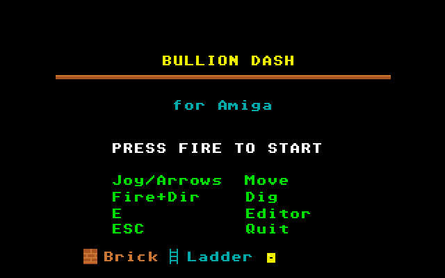

# Bullion Dash
**Platform:** Atari Atari STE (Hatari) · **Source:** `atari_st_games/bullion_dash/` · **Type:** game

A puzzle platformer: collect all the gold, dig traps for the guards and escape, with a built-in level editor (E on the title). It is a port of the Amiga original (`examples/bullion_dash` in amiga_mcp) on `st_port`; the player, enemy, level, editor and sound code are unmodified, editor levels are saved through the AmigaDOS shim as 8.3 files, and the game's own music player runs on the Paula emulation on STE DMA sound. Captured through the agent API.

## Title screen

"BULLION DASH / for Amiga", PRESS FIRE TO START, the controls (joy/arrows move, fire+dir dig, E editor, Esc quit) and the brick, ladder and gold legend.

## Gameplay

Level 1: the green runner at the bottom left, a red guard on the right, orange brick platforms joined by cyan ladders and five gold bars to collect; SCORE 000000, LV:1, GOLD:0/5, LIVES:3.

**Controls:** Cursor keys or joystick: run and climb · Space / Return / fire + left or right: dig · Fire: start · E: editor · Esc: quit
