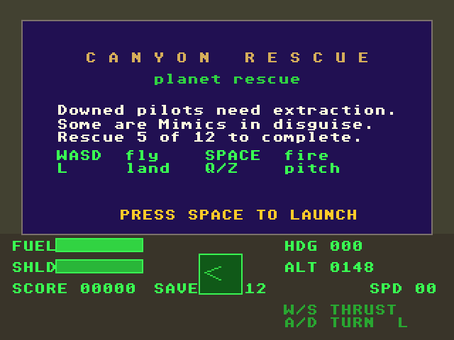
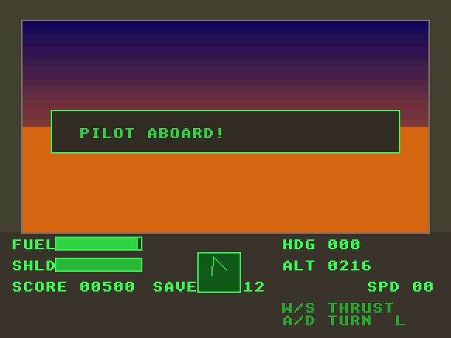

# Canyon Rescue
**Platform:** Atari Falcon030 (Hatari) · **Source:** `atari_st_games/canyon_rescue/` · **Type:** game

Fly the valleys of a fractal planet and rescue downed pilots, some of whom are Mimics in disguise. The Amiga original (`examples/canyon_rescue` in amiga_mcp) targets AGA, so this port runs on the Falcon layer (`falcon_port`): 320x240 in 16-bit true colour, with the game loop body copied verbatim and the AmigaOS parts replaced by IKBD input, the VBL counter and NatFeats logging. `rescue_test.py` drives a scenario test through the agent API: it teleports the ship onto the nearest pilot by writing `ship.x/z` through `/mem`, lands, and checks that a human rescue counts and a Mimic does not (both passed on this run).

## Title screen

The mission briefing panel ("Downed pilots need extraction. Some are Mimics in disguise. Rescue 5 of 12 to complete.") with the keys and PRESS SPACE TO LAUNCH, above the cockpit HUD: FUEL and SHLD bars, compass, HDG, ALT and SPD.

## Gameplay

Flying over the green and orange fractal terrain under a purple-to-orange sky, with three downed pilots visible on the valley floor and a red marker ahead; ALT 0557, SPD 31.

## Gameplay: pilot aboard

From `rescue_test.py`: landed on the planet's orange surface, the airlock has opened and the message reads PILOT ABOARD!; score 00500.

**Controls:** A/D or left/right: turn · W/up: thrust · S/down: brake · Q/Z: pitch · Space: fire / start · L: land · Return: restart · Esc: quit
