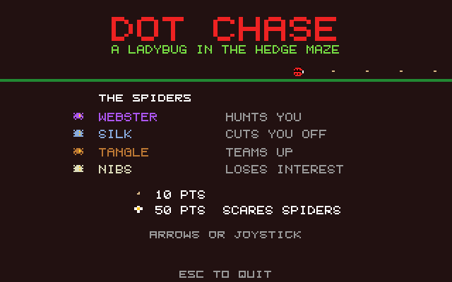
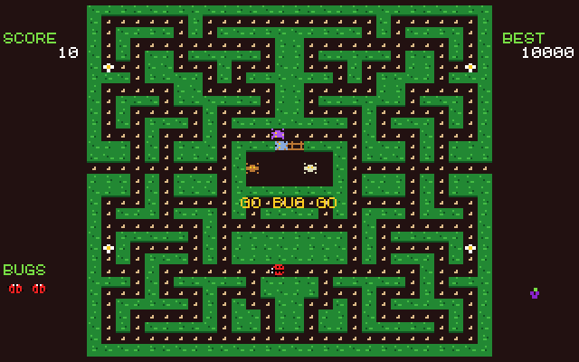

# Dot Chase
**Platform:** Atari Atari STE (Hatari) · **Source:** `atari_st_games/dot_chase/` · **Type:** game

A maze chase: a ladybug gathers seeds in a hedge maze while four spiders hunt it, and a flower turns the tables. It is a port of the Amiga original (`examples/dot_chase` in amiga_mcp) on `st_port`; `game.c` is unmodified, `sound.c` is pointed at the Paula emulation and plays on STE DMA sound, and the game updates once per 50 Hz VBL with drawing once per frame. Captured through the agent API.

## Title screen

"DOT CHASE / A LADYBUG IN THE HEDGE MAZE" and THE SPIDERS: Webster hunts you, Silk cuts you off, Tangle teams up, Nibs loses interest; seeds are 10 points and the flower 50 points and scares spiders.

## Gameplay

The ladybug (red) eating seeds in the lower half of the green hedge maze while the spiders roam the upper corridors and two wait in the pen in the middle; SCORE 170, BEST 10000, two spare bugs.

## Gameplay: start of a life

The start of a round: GO BUG GO under the spider pen, the spiders leaving it and white flowers in the four corners.

**Controls:** Cursor keys / WASD or joystick: move · Space / Return / fire: start · Esc: quit
