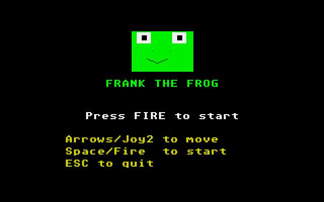

# Frank the Frog
**Platform:** Atari Atari ST (Hatari) · **Source:** `atari_st_games/frank_the_frog/` · **Type:** game

A road-and-river crossing game: hop Frank through the traffic, then ride logs and lily-pad rafts to the four ponds. It is a port of the Amiga original (`examples/frank_the_frog` in amiga_mcp) on `st_port`: `frank.c`, `playfield.c` and `score.c` compile unmodified against the Amiga header shims, the lane objects are drawn from pre-shifted sprites made by the original draw functions, and the original's generated heavy-metal track is replayed on the YM2149. Captured through the Hatari agent API, with joystick input injected through `/input/joystick`.

## Title screen

A big green frog face above "FRANK THE FROG", Press FIRE to start, and the controls: Arrows/Joy2 to move, Space/Fire to start, ESC to quit.

## Gameplay

Frank (green) two hops into the road, between a yellow car and a blue one, with red cars and purple buses in the other lanes; logs and lily pads drift on the blue river above. SCORE 000020, HI 000030, LVL 1 and three lives.

**Controls:** Cursor keys or joystick: hop · Space / Return / fire: start · M: music on/off · Esc: quit
