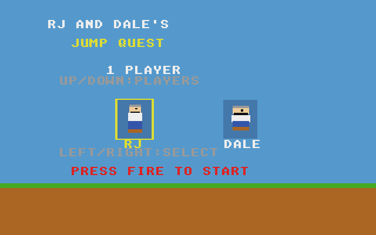
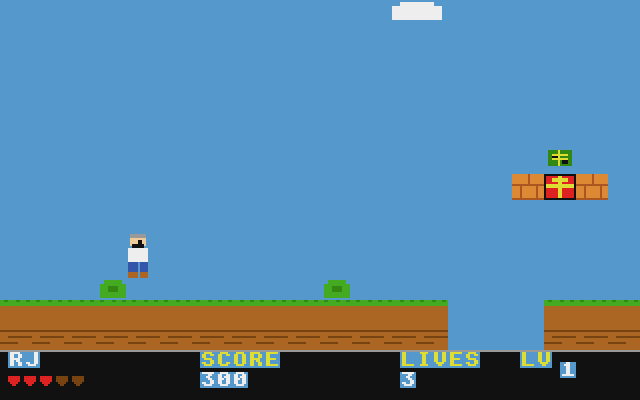

# Jump Quest
**Platform:** Atari Atari STE (Hatari) · **Source:** `atari_st_games/jump_quest/` · **Type:** game

RJ and Dale's Jump Quest, a platformer for one or two players taking turns. It is a port of the Amiga original (`examples/jump_quest` in amiga_mcp) on `st_port`: `player.c`, `enemy.c`, `items.c`, `hud.c`, `title.c` and the levels are unmodified, the level drawing uses a tile cache, and the chiptune and effects drive Paula registers that point at the layer's Paula emulation on STE DMA sound. Captured through the agent API.

## Title screen

"RJ AND DALE'S JUMP QUEST" on a blue sky: 1 PLAYER (up/down for players), RJ highlighted in a yellow box next to Dale (left/right to select) and PRESS FIRE TO START above the grass.

## Gameplay

RJ on the grass of level 1 next to a floppy-disk pickup, with brick blocks holding a gift above, green bushes and a gap in the ground ahead. The HUD shows RJ's hearts, SCORE 200, LIVES 3 and LV 1.

## Gameplay: jumping

RJ in mid-jump further along level 1, under a brick block with a gift; SCORE 300.

**Controls:** Cursor keys, WASD or joystick: move · Space, Alt, Z, X or fire: jump · Return: start · Esc: quit
