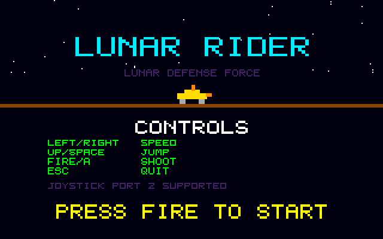
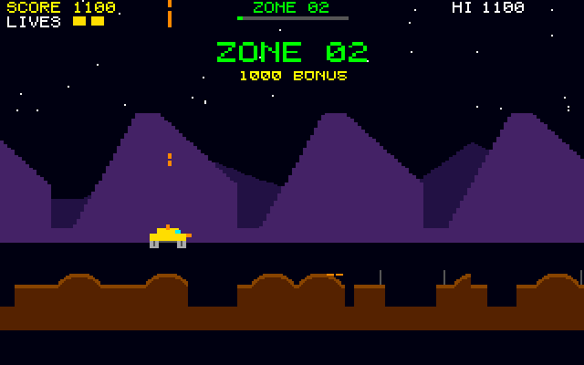

# Lunar Rider
**Platform:** Atari Atari STE (Hatari) · **Source:** `atari_st_games/lunar_rider/` · **Type:** game

A side-scrolling moon-buggy ride: jump craters, shoot rocks and reach each zone. It is a port of the Amiga original (`examples/lunar_rider` in amiga_mcp) on `st_port`; `game.c` is unmodified, `sound.c` drops two CIA reads (a bus error on the ST) and plays on the Paula emulation, and the two mountain layers are pre-rendered into wide strips that the STE blitter copies each frame. Captured through the agent API; the game logs a `checkpoint_dist` address that can be written to jump to the next zone.

## Title screen

"LUNAR RIDER / LUNAR DEFENSE FORCE" with the yellow buggy on the horizon, the CONTROLS list (left/right speed, up/space jump, fire/A shoot, Esc quit), JOYSTICK PORT 2 SUPPORTED and PRESS FIRE TO START.

## Gameplay

The buggy on the brown moon surface fires a shot straight up in front of purple mountains, with an orange-and-red explosion on the ground ahead; SCORE 100, ZONE 01.

## Gameplay: next zone

"ZONE 02 / 1000 BONUS" as the buggy reaches the checkpoint; SCORE 1100.

**Controls:** Left / right (or D): slow down / speed up · Up, W, Space or joystick up: jump · A or fire: shoot · Esc: quit
