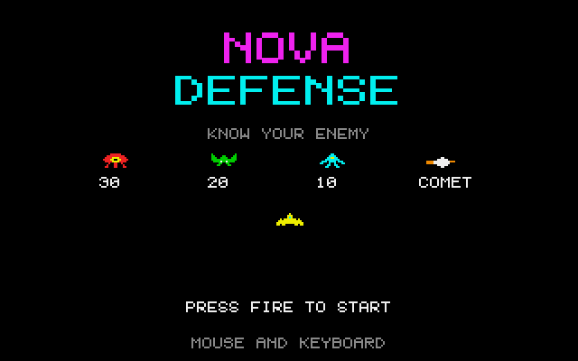
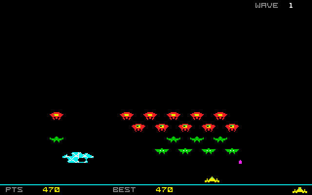

# Nova Defense
**Platform:** Atari Atari ST (Hatari) · **Source:** `atari_st_games/nova_defense/` · **Type:** game

A fixed-screen alien shooter: 48 aliens in six staggered rows, crystal shields and a passing comet. It is a port of the Amiga original (`examples/nova_defense` in amiga_mcp) on `st_port`; `game.c` is unchanged except for a cheaper alien-versus-shield overlap test (the original took ~2 s a frame on an 8 MHz 68000, found with the agent API's `/debug/break` and a backtrace), and `draw.c` turns the aliens into pre-shifted bit-plane masks drawn a whole row at a time. The gameplay shots were taken while `bot.py` played through the agent API.

## Title screen

"NOVA DEFENSE" in magenta and cyan above KNOW YOUR ENEMY: the red alien worth 30, the green one 20, the cyan one 10 and the comet, with the yellow player ship below and PRESS FIRE TO START.

## Gameplay

Wave 1 with the bot playing: rows of red, green and cyan aliens above three cyan crystal shields already chipped by shots, the yellow ship at the bottom, PTS 200 and BEST 200.

## Gameplay: shields gone

Later in wave 1: the thinned-out swarm has come down to the shield line, two of the three shields are gone, PTS 470.

**Controls:** Mouse, cursor keys / A,D or joystick: move · Left button, Space, Alt or fire: shoot · Esc: quit
