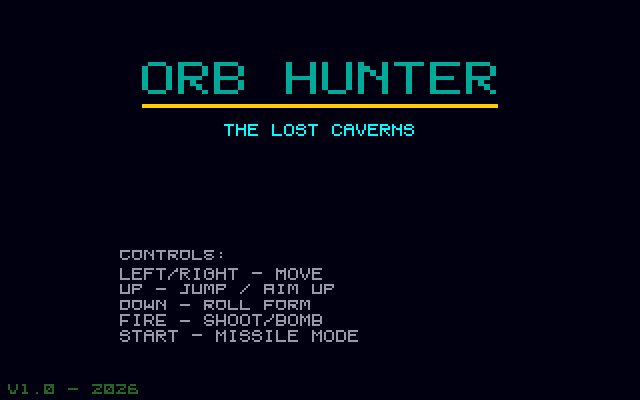
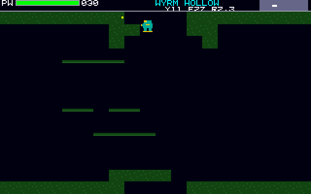

# Orb Hunter
**Platform:** Atari Atari STE (Hatari) · **Source:** `atari_st_games/orb_hunter/` · **Type:** game

A cavern-exploration platformer with tile-based rooms, power-ups and bosses. It is a port of the Amiga original (`examples/orb_hunter` in amiga_mcp) on `st_port`; `game.c` and `levels.c` are unmodified, and effects (and an optional `MUSIC.MOD`) play on the C ptplayer over the Paula emulation on STE DMA sound. The Amiga's bridge hooks (give items, full health) are writes to `gs.hunter` through the agent API's `/mem`. Captured through the agent API.

## Title screen

"ORB HUNTER / THE LOST CAVERNS" in teal with the controls: left/right move, up jump / aim up, down roll form, fire shoot/bomb, start missile mode; V1.0 - 2026 at the bottom.

## Gameplay

The Citadel: the teal hunter fires along the grey stone floor at a magenta crawler, under a stone cross and a blue ladder; the PW bar is at 015.

## Gameplay: Wyrm Hollow

Wyrm Hollow, a green cavern of moss blocks and thin ledges, with the hunter at the top; PW 030.

**Controls:** Cursor keys / WASD or joystick: move · Up: jump / aim up, down: roll form · Space / Alt / fire: shoot · Return: start · Esc: quit
