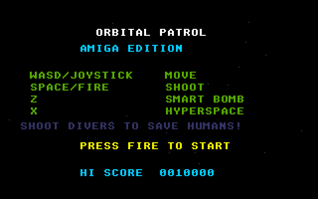
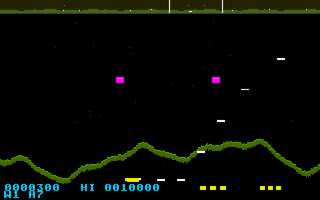

# Orbital Patrol
**Platform:** Atari Atari STE (Hatari) · **Source:** `atari_st_games/orbital_patrol/` · **Type:** game

A side-scrolling planet-defence shooter: protect the humans from the abductors across a wraparound world, with a scanner at the top, smart bombs and hyperspace. It is a port of the Amiga original (`examples/orbital_patrol` in amiga_mcp) on `st_port`; `game.c`, `sound.c` and `score.c` are unmodified, and `sound.c` plays the original MOD ("Patrol Drive") through the C ptplayer on the layer's Paula emulation on STE DMA sound. The state machine is split into a 50 Hz logic step and a per-frame draw so it keeps the Amiga's speed. Captured through the agent API.

## Title screen

"ORBITAL PATROL / AMIGA EDITION", the controls (WASD/joystick move, Space/fire shoot, Z smart bomb, X hyperspace), SHOOT DIVERS TO SAVE HUMANS!, PRESS FIRE TO START and HI SCORE 0010000.

## Gameplay

The yellow ship at the top fires white shots while two green landers carry humans up from the green mountain range; the scanner strip at the top shows the whole world. Score 0000150, wave 1, 10 humans left.

## Gameplay: baiters

Two magenta enemies close in on the ship over the mountains; score 0000300, wave 1, 7 humans left, smart bombs shown as yellow blocks at the bottom.

**Controls:** Cursor keys, WASD or joystick: fly · Space, Alt, Shift or fire: shoot · Z: smart bomb · H or X: hyperspace · Esc: quit
