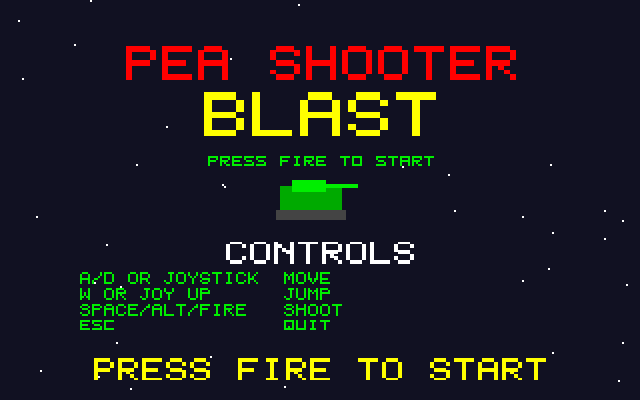
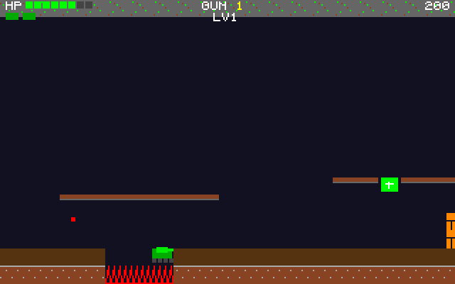

# Pea Shooter Blast
**Platform:** Atari Atari STE (Hatari) · **Source:** `atari_st_games/pea_shooter_blast/` · **Type:** game

Side-scrolling tank action with platforms, pickups and eight weapon levels over three levels. It is a port of the Amiga original (`examples/pea_shooter_blast` in amiga_mcp) on `st_port`; `game.c` and `levels.c` are unmodified, the loop runs the game logic once per 50 Hz VBL and draws once per frame, and the original MOD plays on STE DMA sound. The Amiga's bridge hooks (heal, max weapon, extra life) are writes to `gs` through the agent API's `/mem`. Captured through the agent API.

## Title screen

"PEA SHOOTER / BLAST" in red and yellow with the green tank and the controls (A/D or joystick move, W or joy up jump, Space/Alt/fire shoot, Esc quit).

## Gameplay

The green tank fires a stream of peas at a red walker on level 1, with floating brown ledges above; HP bar full, GUN 1, LV1.

## Gameplay: health pickup

Further along: a green health cross on a ledge, an orange turret post and spike pits in the ground; HP partly drained, score 200.

**Controls:** A/D, cursor keys or joystick: move · W, up or joystick up: jump · Space, Alt or fire: shoot (one shot per press) · Esc: quit
