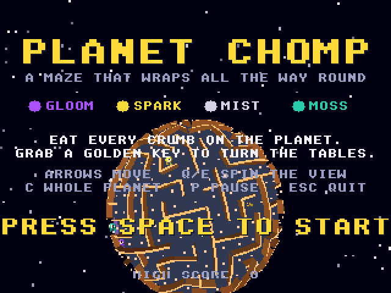
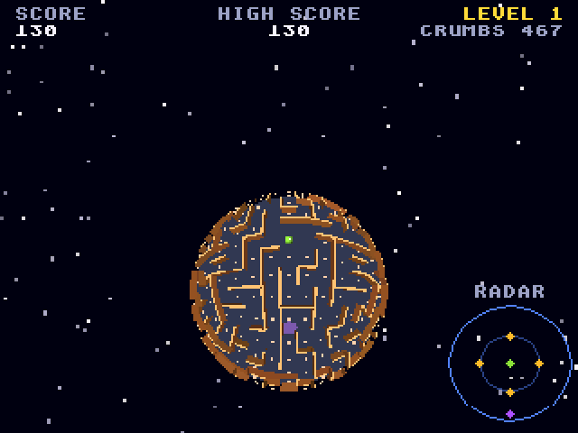

# Planet Chomp
**Platform:** Atari Falcon + 68060 (CT60) (Hatari) · **Source:** `atari_st_games/planet_chomp/` · **Type:** game

A maze chase on a tiny planet: the maze wraps all the way round a sphere, and you eat every crumb while dodging four spooks, grabbing a golden key to turn the tables. It is one of amiga_mcp's 3DO ports (`examples/planet_chomp`); everything except `softcel.c` (a `movem` depth-buffer clear) is unmodified and runs on the `falcon_3do` layer. Like Rolling Steel, it needs an accelerated Falcon (68060, CT60-style). Captured through the agent API.

## Title screen

"PLANET CHOMP / A MAZE THAT WRAPS ALL THE WAY ROUND" with the four spooks (Gloom, Spark, Mist, Moss), the instructions and PRESS SPACE TO START over the rotating maze planet.

## Gameplay

Close up on the planet: the green chomper among orange maze walls and white crumbs curving over the sphere, a purple spook below, the RADAR at the bottom right; SCORE 110, LEVEL 1, CRUMBS 469.

## Gameplay: whole planet

Holding C shows the whole planet: the full maze on the sphere with the chomper near the top and a spook below; SCORE 130, CRUMBS 467.

**Controls:** Cursor keys / WASD or joystick: steer · Q / E: spin the view · C: whole planet · P: pause · Space: start · Esc: quit
