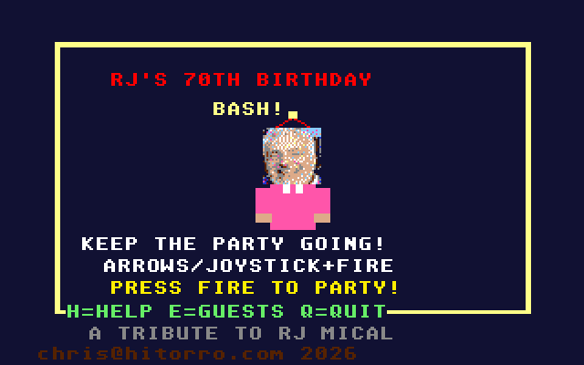
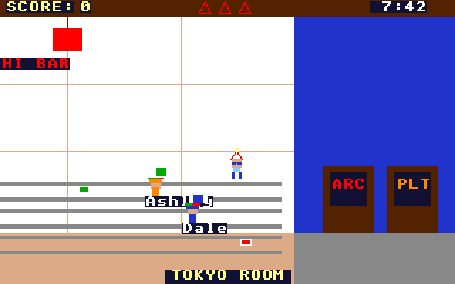

# RJ's Birthday Bash
**Platform:** Atari Atari STE (Hatari) · **Source:** `atari_st_games/rj_birthday/` · **Type:** game

An arcade party-management game written as a tribute to RJ Mical (Intuition, the Amiga, the Atari Lynx, the 3DO) for his 70th birthday: run the party across six themed rooms of RJ's house, keeping guests happy, catching gifts and serving food. It is a port of the Amiga original (`examples/rj_birthday` in amiga_mcp) on `st_port`; `game.c` and `rooms.c` are unmodified, the guest list and scores load through the AmigaDOS shim, and the two MODs and four synthetic-speech clips play through ptplayer on the Paula emulation (STE, 2 MB). Captured through the agent API.

## Title screen

"RJ'S 70TH BIRTHDAY BASH!" in a yellow frame around a dithered portrait of RJ in a party hat, KEEP THE PARTY GOING!, PRESS FIRE TO PARTY!, H=HELP E=GUESTS Q=QUIT and A TRIBUTE TO RJ MICAL.

## Gameplay

The Tokyo Room under the SUSHI BAR sign: RJ in a party hat at the bottom and guests Marcelis on the conveyor rows; SCORE 0, three lives and the party clock at 7:31.

## Gameplay: arcade doors

Further along the Tokyo Room, guests Ash and Dale by the conveyor and the ARC and PLT doors of the next room at the right; clock 7:42.

**Controls:** Cursor keys or joystick: move, Space / fire: act · Title: H help, E guests, Q quit · Esc: leave the party
